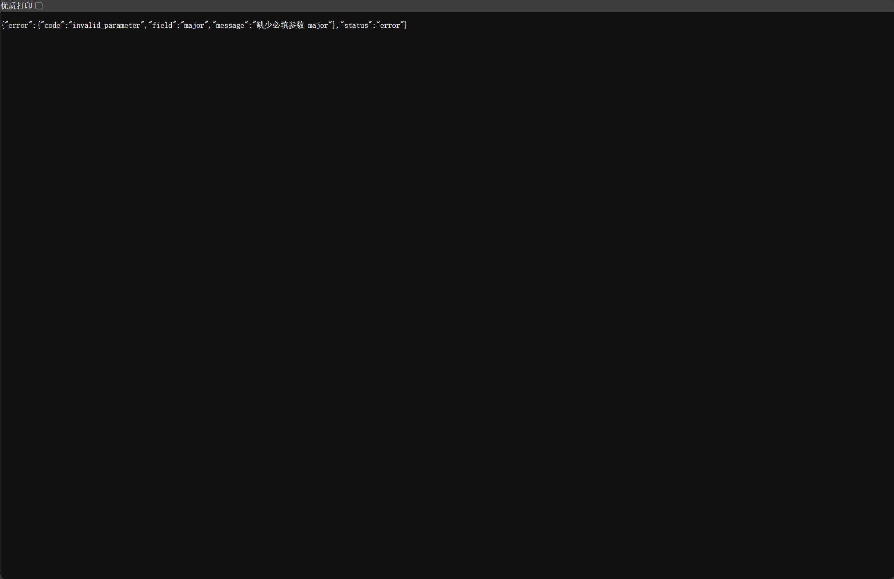

# Day 6 开发记录：Flask API 搭建

## 本轮 Prompt（逐字原文）

```text
现在实现CampusAI基础Flask API。

请先阅读：

AGENTS.md
docs/PRD.md
当前数据库结构

实现：

GET /api/classrooms/available
GET /api/canteens/stats
GET /api/industry/skills
GET /api/industry/gap

要求：

1. Flask。
2. SQLite。
3. 使用参数化查询。
4. AI不参与。
5. 返回JSON。
6. 错误参数返回合理HTTP状态码。
7. 业务查询函数和Flask路由分离。
8. 增加pytest测试。
9. 不修改frontend。

只修改必要文件。
```

 1. 今日任务

编写基础后端接口，实现 4 个核心 API（教室、食堂、产教、技能缺口），要求使用 Flask + SQLite，参数化查询，不接入 AI，并且包含单元测试。


2. AI 协作与实现方案

	AI 拆解方案：Harness 阅读了 `AGENTS.md`、`docs/PRD.md` 和 `docs/DATABASE.md` 后，建议按模块化拆分代码。

	生成文件：新增 9 个文件，包括 `app.py`、`routes.py`（路由解析）、`queries.py`（SQL查询与计算，不包含 Flask 逻辑）、`validators.py`（类型与范围校验）、`db.py`（连接管理）等。

关键实现口径：

    1. 教室搜索使用时间段相交判定，并附带排序。

    2. 食堂拥挤度使用历史日均人数除以食堂容量进行归一化处理。

    3. 产教缺口采用加权覆盖率计算。

	参数校验：使用 `whereBuilder` 动态生成 SQL 片段，严格进行参数绑定，避免 SQL 注入。


 3. 异常测试与截图证据

	在浏览器中测试 `/api/industry/gap` 接口时，故意不传参数，系统正确返回了 400 错误提示：

	`{"error": {"code": "invalid_parameter", "field": "major", "message": "缺少必填参数 major"}, "status": "error"}`


	这说明后端参数校验逻辑正常工作，成功拦截了非法请求。

	

4. 测试结果与提交

	单元测试：`pytest -q` 显示 68 个测试用例全部通过（68 passed）。

	Git 提交：`feat: add flask API for classrooms, canteens and industry skills`（仅新增文件，未修改前端和原有代码）。

