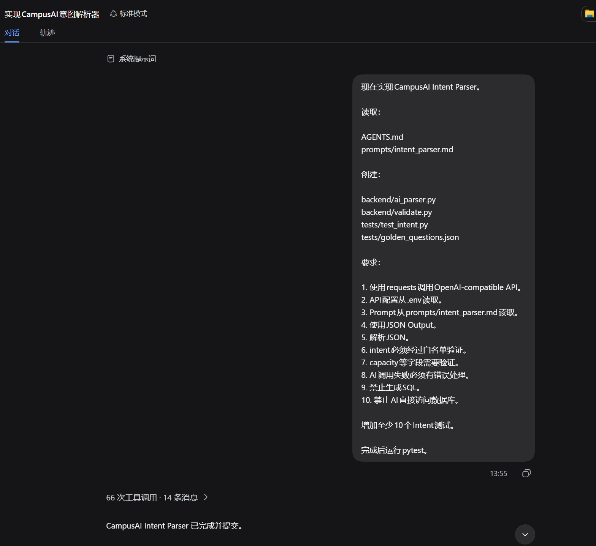
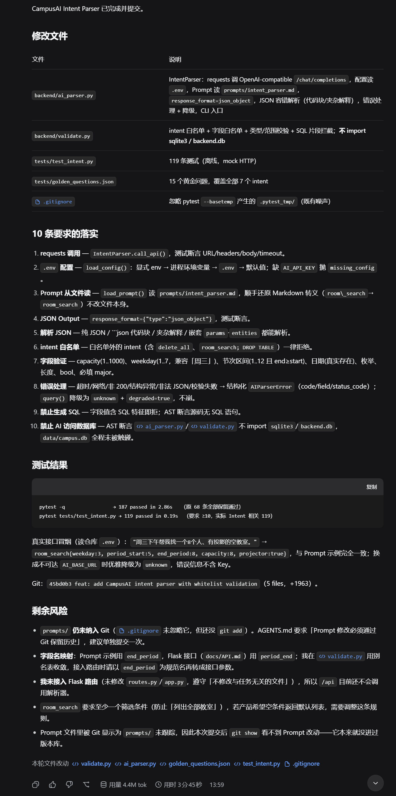

\# AI协作记录：Intent Parser（Day 8）

1\. 今日任务

让 Harness 编写 `backend/ai\_parser.py` 和 `validate.py`，将用户自然语言解析为结构化 JSON，要求绝对禁止生成 SQL 或访问数据库，并增加至少 10 个测试。

2\. 第一轮 Prompt

3\. AI 建议与执行亮点

安全防线：AI 使用 AST 静态分析确保代码中无 SQL 注入，并将异常统一优雅降级为 `unknown` 意图，防崩溃能力极强。

测试覆盖：AI 在 `tests/test\_intent.py` 中增加了 119 个测试用例，最终 `pytest -q` 显示 119 passed。

边界遵守：AI 严格遵守了“不修改与任务无关文件”的纪律，未强行将解析器塞入 Flask 路由，留到 Day 10 对接。

4\. 执行结果与剩余风险

待解决：`prompts/` 目录还未被 Git 追踪，我会立刻执行 `git add` 补上。

业务决策：保留 `room\_search` 至少一个筛选条件的限制，防止全库扫描，符合安全防御要求。

字段命名：`end\_period` 与 Flask 路由暂不一致，留到 Day 10 对接真实 API 时统一。

5\. Git 提交

`feat: add natural language intent parser`

