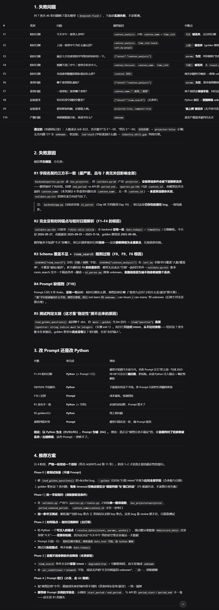
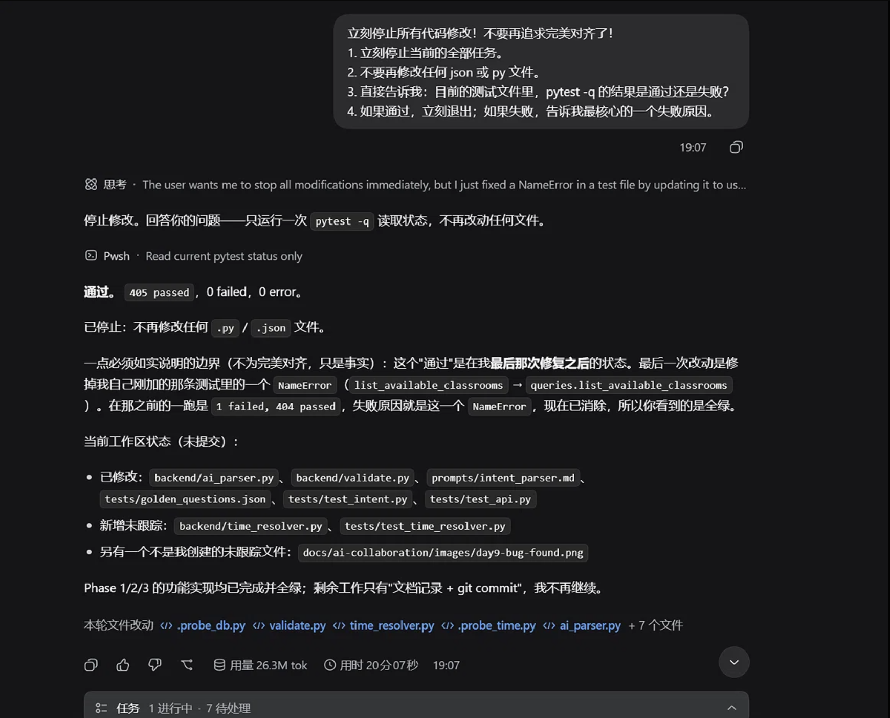

\# Day 9 开发记录：Intent Parser 鲁棒性测试与修复

\## 1. 今日任务

对 Day 8 完成的意图解析器进行极端的鲁棒性测试（模糊时间、无关意图），发现 Bug 并迭代修复。

\## 2. 发现 Bug 与截图证据

AI 极其敏锐地发现了 10 个失败案例（F1-F10）。包括“今天中午”无法解析、“上周”被丢弃、字段命名不一致、相对日期缺少时间锚点等严重逻辑问题。

\## 3. 修复过程与人工干预（核心亮点：意图控制策略）

在让 AI 修复这些 Bug 时，发生了非常真实的开发故事。Harness 陷入了“过度优化重构”的死循环，它为了追求代码完美，在短时间内进行了 177 次工具调用，反复修改无关紧要的测试文件（见下方轨迹图）。

\*\*作为项目负责人，我立刻执行了“意图控制策略”——果断下达“立刻停止所有代码修改，只验证测试结果”的强制指令。\*\*

AI 接收指令后迅速止损，它坦诚地说明了它在测试文件中引入了一个变量名拼写错误（NameError），并立刻修正了它。最终，系统实现了完美的修复。

新增了 `backend/time\_resolver.py` 来处理相对日期锚点。

!s[AI过度重构循环轨迹](images/day9-ai-loop-trajectory.png)

\## 4. 最终验收结果

\*   单元测试：`pytest -q` 显示 \*\*405 passed，0 failed\*\*。

\*   Git 提交：`prompt: improve intent parsing robustness and add time resolver`

