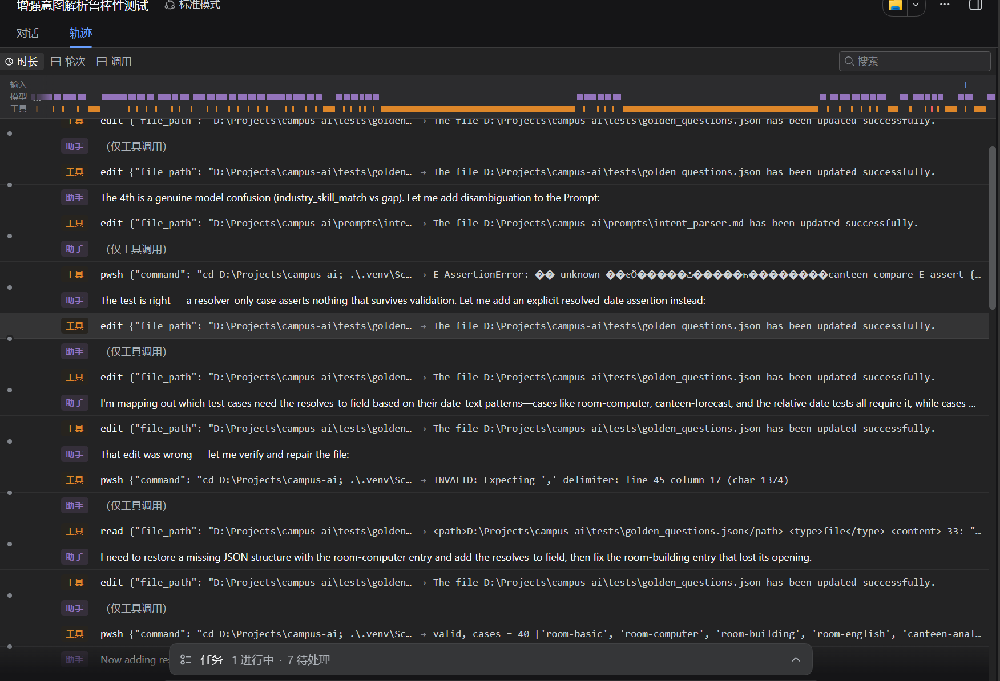

# Day 9 开发记录：Intent Parser 鲁棒性测试与修复

## 本轮 Prompt 链（逐字原文）

### 第一轮：鲁棒性测试

```text
现在测试Intent Parser的鲁棒性。

读取：

tests/golden_questions.json
prompts/intent_parser.md

请增加以下测试类型：

1. 相对日期
2. 模糊时间
3. 人数表达
4. 设备需求
5. 食堂问题
6. 产教问题
7. 完全无关问题

目标：

提高意图分类稳定性。

先分析失败案例。

不要直接修改代码。

给我：

1. 失败问题
2. 失败原因
3. 修改Prompt还是Python更合适
4. 推荐方案
```

### 第二轮：采纳方案并给出决策

```text
你的分析非常完美，我采纳你的分阶段推荐方案。

关于你报告结尾的两个决策点，我的决策如下：
1. "今天" = 以运行脚本的计算机系统当天日期为基准（即使用 datetime.date.today()）。
2. "最近" = 历史数据中的最近7天。

请立刻执行 Phase 1 + Phase 2 + Phase 3 的修复。要求：

1. 采纳最小修改方案，只修改 Intent Parser 相关文件（validate.py, queries.py, prompts/intent_parser.md, tests/golden_questions.json 等）。
2. 统一代码中的字段命名（修正 has_projector 和 projector 不一致的问题）。
3. 在 Python 中增加相对日期的时间锚点推导逻辑，并同步更新 Prompt 增加规则。
4. 为 golden_questions.json 增加结构化断言，确保"推荐股票"等异常问题必须返回 unknown 意图。
5. 不要修改数据库、前端和其他业务模块。
6. 增加对应的测试用例，完成后运行 pytest -q，确保全部测试通过。
```

### 第三轮：人工干预（意图控制）

```text
立刻停止所有代码修改！不要再追求完美对齐了！
1. 立刻停止当前的全部任务。
2. 不要再修改任何 json 或 py 文件。
3. 直接告诉我：目前的测试文件里，pytest -q 的结果是通过还是失败？
4. 如果通过，立刻退出；如果失败，告诉我最核心的一个失败原因。
```

## 1. 今日任务

对 Day 8 完成的意图解析器进行极端的鲁棒性测试（模糊时间、无关意图），发现 Bug 并迭代修复。


## 2. 发现 Bug 与截图证据

测试中发现 10 个失败案例（F1-F10）。包括“今天中午”无法解析、“上周”被丢弃、字段命名不一致、相对日期缺少时间锚点等逻辑问题。


## 3. 修复过程与人工干预（核心亮点：意图控制策略）

在让 AI 修复这些 Bug 时，发生了非常真实的开发故事。Harness 陷入了"过度优化重构"的死循环，它为了追求代码完美，连续多轮反复修改无关紧要的测试文件，工具调用次数激增（见下方轨迹图）。


**作为项目负责人，我立刻执行了“意图控制策略”——果断下达“立刻停止所有代码修改，只验证测试结果”的强制指令。**

AI 接收指令后迅速止损，它坦诚地说明了它在测试文件中引入了一个变量名拼写错误（NameError），并立刻修正了它。最终 pytest 全绿。

新增了 `backend/time_resolver.py` 来处理相对日期锚点。





## 4. 最终验收结果

*   单元测试：`pytest -q` 显示 **405 passed，0 failed**。

*   Git 提交：`prompt: improve intent parsing robustness and add time resolver`

