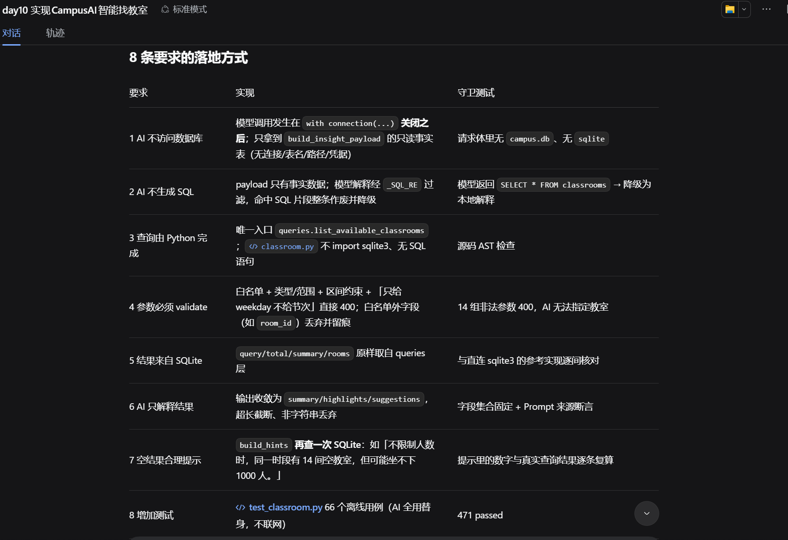
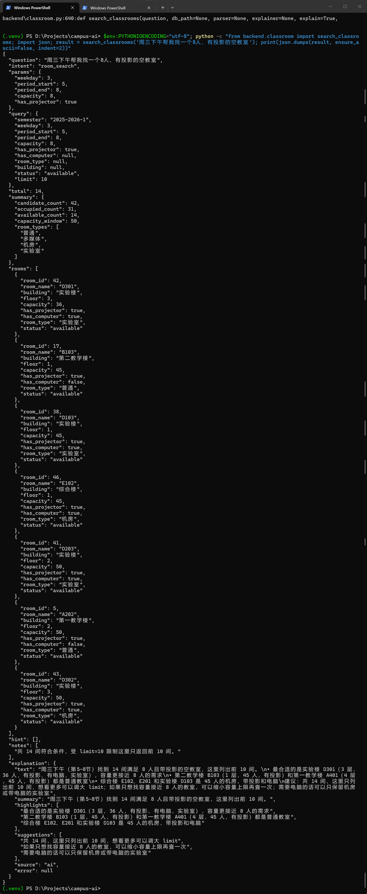

# AI协作记录：AI 智能找教室（Day 10）

## 本轮 Prompt（逐字原文）

```text
现在实现CampusAI AI智能找教室。

用户示例：

“周三下午帮我找一个8人、有投影的空教室。”

完整链路：

用户输入
→ Intent Parser
→ 参数验证
→ classroom service
→ SQLite
→ 返回候选教室
→ AI解释结果

要求：

新增：

backend/classroom.py

修改必要的backend路由。

新增：

prompts/insight_generator.md

要求：

1. AI不能直接访问数据库。
2. AI不能生成SQL。
3. 教室查询必须由Python完成。
4. 查询参数必须经过validate。
5. 查询结果必须来自SQLite。
6. AI只能解释查询结果。
7. 查询为空时给出合理提示。
8. 增加测试。

不要修改食堂和产教模块。
```

## 1. 今日任务
让 Harness 实现“用户输入 -> Intent Parser -> 参数验证 -> 教室查询 -> SQLite -> AI 解释”的完整链路。
**核心约束**：AI 不能直接访问数据库、不能生成 SQL，必须由 Python 查询 SQLite。

## 2. 架构落地与安全防线（核心亮点）
Harness 严格遵循了 AGENTS.md 的工程纪律，实现了“分层不改架构”。它不仅复用了底层的 `queries.py` 和 `validate.py`，还在编排层 `classroom.py` 中做到了：
*   **连接先关、再调模型**：Python 查完数据库关闭连接后，只把“只读事实表”传给 AI 解释，从结构上保证 AI 不碰数据库。
*   **拦截非法输出**：解释文本经正则过滤，如果模型试图塞入 SQL 语句，将直接降级为本地兜底文案，防止注入。
*   **空结果不靠猜**：如果查不到空教室，`build_hints` 会再次查询 SQLite，给出“不限制人数时有14间，但可能坐不下1000人”这类可复算的明确建议。



## 3. 真实链路人工验证（核心证据）
在完成了全部自动化测试（471 passed）后，我在终端执行了真实链路测试：
输入：“周三下午帮我找一个8人、有投影的空教室。”
*   **结果**：成功解析出 `room_search` 意图（weekday=3, period=5-8, capacity=8, projector=true），查出 14 间符合条件的教室。
*   **AI解释**：AI 真实调用了 DeepSeek API（`source: "ai"`），像人类助理一样给出了建议：“最合适的是实验楼 D301，容量更接近 8 人的需求...”。


## 4. 真实 Bug 修复与边界控制（体现工程素养）
*   **Bug 修复**：第一轮测试跑出 `validate_room_params` 调 `validate_intent` 时漏传 `warnings`，导致模型编造的 `room_id` 被静默丢弃（静默改变查询语义）。补上参数后测试转绿。
*   **拒绝过度修改**：针对 `has_projector=false` 的已知缺口，AI 没有擅自去改 `queries.py`（避免影响旧功能与测试），而是选择在响应 `notes` 里提示，契合了“不破坏旧功能”的纪律。

## 5. 最终验收结果与剩余风险
*   **测试结果**：`python -m pytest -q` 全量回归，**471 passed**。
*   **剩余风险**：解释质量依赖 Prompt 约束，尚未做数字级一致性校验（如把60人说成8人）；真实 AI 路径需在 `.env` 配好 Key 才能验收。

## 6. Git 提交
`feat: add AI classroom search (intent -> validate -> sqlite -> insight)`