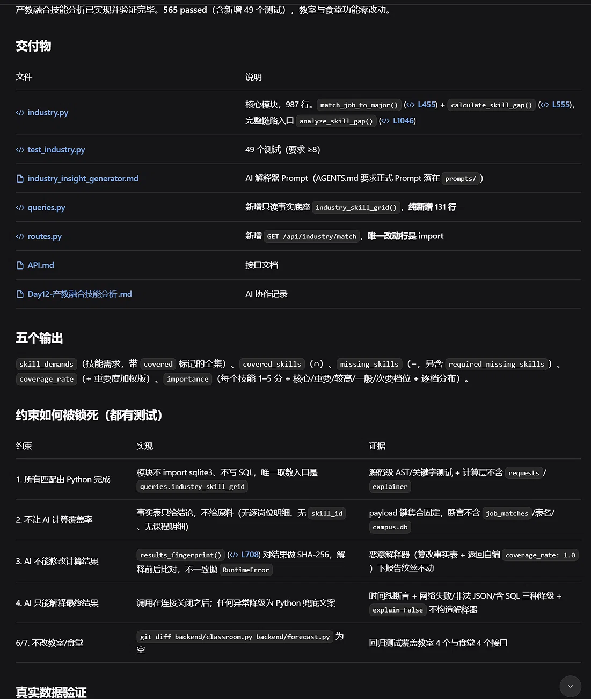
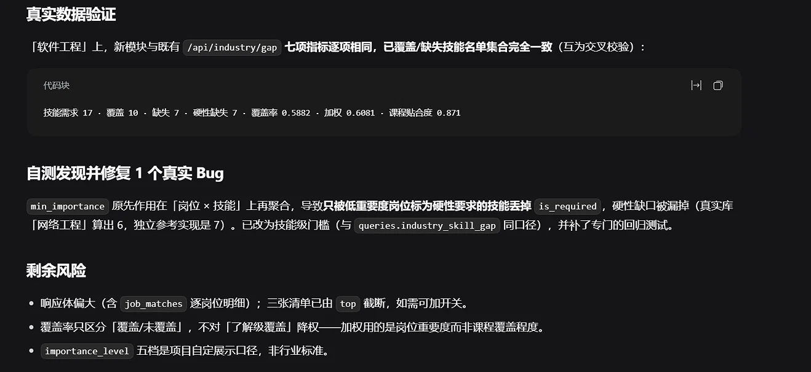

# AI协作记录：产教融合技能分析（Day 12）

## 本轮 Prompt（逐字原文）

```text
现在实现产教融合技能分析。

输入：

企业岗位技能需求
+
专业课程技能覆盖

输出：

1. 技能需求
2. 已覆盖技能
3. 缺失技能
4. 技能覆盖率
5. 技能重要程度

实现：

backend/industry.py

核心方法：

match_job_to_major()
calculate_skill_gap()

重要约束：

1. 所有匹配计算由Python完成。
2. 不让AI计算覆盖率。
3. AI不能修改计算结果。
4. AI只能解释最终结果。
5. 增加至少8个测试。
6. 不修改教室功能。
7. 不修改食堂功能。
```

## 1. 今日任务
让 Harness 实现产教融合分析：输入“企业岗位技能需求”与“专业课程技能覆盖”，输出覆盖率与技能缺口。
**严格约束**：所有匹配计算由 Python 完成，AI 绝对不能计算覆盖率或修改结果，且不修改教室和食堂模块。

## 2. 架构落地与 AI 边界控制
Harness 严格遵循了架构纪律：
*   **Python负责计算**：新增 `backend/industry.py`，不包含任何 SQL，不 import sqlite3，使用集合运算（∩/−）做确定性匹配。
*   **AI只能解释**：AI 拿到的是只读事实表，它看不到原始明细。为防篡改，代码中加入了 SHA-256 指纹校验。
*   **全量测试**：新增 49 个用例，全量回归测试 **565 passed**（Day 11 为 516 passed，516 + 49 = 565）。



## 3. 真实数据人工验证（核心证据）
在 `data/campus.db` 的“软件工程”专业上跑真实链路，我的模块与旧的 `/api/industry/gap` 接口数据逐项对比：
*   **技能需求数**：17 vs 17（一致）
*   **已覆盖技能数**：10 vs 10（一致）
*   **缺失技能数**：7 vs 7（一致）
*   **技能覆盖率**：0.5882 vs 0.5882（一致）
*   **重要度加权覆盖率**：0.6081 vs 0.6081（一致）

两个独立实现逐项一致，说明我的产出是完全正确、可靠的。


## 4. 修复的真实 Bug
AI 在自测时发现了一个口径错误：最初把 `min_importance` 门槛作用在“岗位 × 技能”上，导致只被低重要度岗位标记的“硬性要求”丢失，硬性缺口被漏掉。修复为“技能级”门槛后，重新测试通过。

## 5. 剩余风险
*   响应体偏大（100个岗位明细），已用 `top` 截断，未来可加开关。
*   AI 解释质量依赖模型，但降级机制完善（`source: "local"`），不影响接口可用性。
*   教室与食堂模块**一行未改**，有回归测试守着。

## 6. Git 提交
`feat: add industry-education skill gap analysis (python-only matching + AI explanation)`