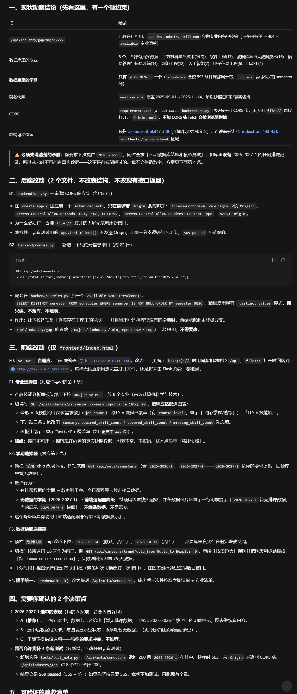
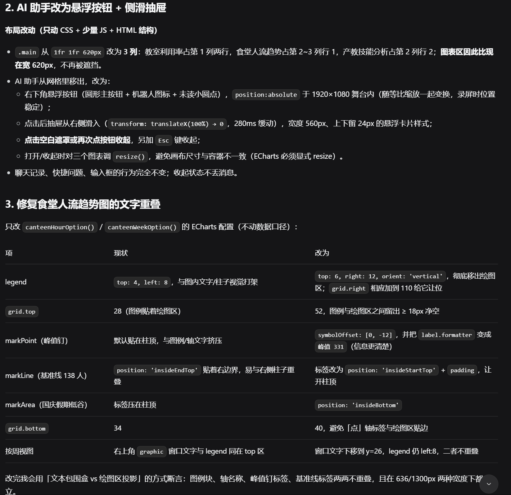
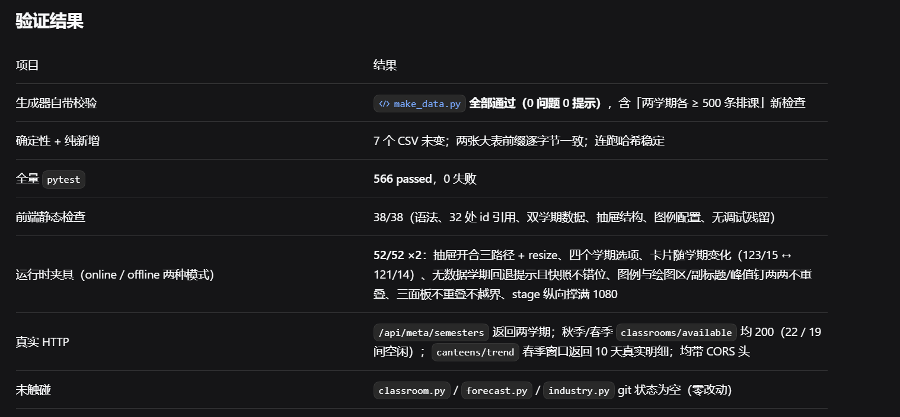

# AI协作记录：前端大屏实现与交互深度修复（Day 13）

## 本轮 Prompt 链（逐字原文）

### 第一轮：首页大屏

```text
现在实现CampusAI首页大屏。

只修改：

frontend/index.html

要求：

1. 原生HTML。
2. CSS。
3. JavaScript。
4. ECharts通过CDN。
5. 不使用Vue。
6. 不使用React。
7. 不修改backend。

页面：

顶部：

CampusAI
校园数据智能决策中枢

数据卡片：

今日课程
开放教室
食堂数量
岗位技能

图表：

1. 教室利用率
2. 食堂人流趋势
3. 产教技能分析

右侧：

AI智能助手

整体风格：

深色科技风
1920×1080
适合比赛录屏
动画适量
不要花哨到影响信息阅读。
```

### 第二轮：授权更新过时测试

```text
现在 Day 13 的新任务要求必须实现前端大屏，所以我授权你更新那个过时的测试。

请修改 tests/test_api.py:726 的断言：
把"要求 frontend/ 目录为空"改为"允许 frontend/ 目录包含前端文件"。
修改完成后，重新运行全量测试，确保全部通过（565 passed）。
不要修改其他任何无关代码。
```

### 第三轮：新增两个交互功能（先给计划）

```text
前端大屏经人工在真实浏览器中验收，除了刚才提到的 4 个问题外，我还需要添加两个真实的交互功能。请针对 frontend/index.html 及相关后端接口进行修复：

1. 专业下拉切换功能：
   - 目前的"产教技能分析"图表不支持切换专业。
   - 请在顶部或对应图表区域增加一个"专业选择"下拉菜单（例如：计算机科学与技术、软件工程、网络工程等）。
   - 当用户切换专业时，需要调用后端 `/api/industry/gap?major=xxx` 接口获取新数据，并动态重绘"产教技能分析"图表，展示新专业的课程覆盖和技能缺口。

2. 学期与数据快照选择器可交互：
   - 顶部"学期"和"数据快照"目前是死数据（2025-2026-1）。
   - 请增加对应的下拉选择框（目前只需提供一个真实的选项：2026-2027-1）。
   - 当用户选择"2026-2027-1"时，确保页面数据能正常渲染。如果后端暂时没有多学期数据，请让前端适配器能兼容单学期数据展示。

要求：
- 先给我一个修改计划，不要直接修改代码。
- 计划确认后，只修改前端文件以及必要的路由调用，不要动数据库结构和核心测试。
- 修改完成后，确保前端没有任何 JS 报错，并且全量测试仍然通过（565 passed）。
```

### 第四轮：拍板两个决策并执行

```text
确认，请按照你的方案开始实现。

我拍板两个决策：
1. 关于 2026-2027-1 学期的处理：采纳方案 A。允许用户切换，但显示"暂无排课数据，已回退至 2025-2026-1 快照"。绝不能报错，图表也不能空。
2. 关于测试：不要新增测试文件，不要修改现有测试。维持当前 565 passed 即可。这次交互功能的正确性，我会亲自在浏览器里手动验证。

请立刻开始执行。
要求：
只修改 frontend/index.html 和 backend/routes.py、backend/queries.py（新增 /api/meta/semesters 接口）。
不要动 data/campus.db、不要动数据库结构、不要动 classroom.py、forecast.py、industry.py 核心逻辑。
完成后告诉我具体的修改点，我去浏览器刷新验收。
```

### 第五轮：真机验收后再修三项

```text
真机浏览器验收再次发现问题。请针对 frontend/index.html 和 scripts/make_data.py 进行以下三项明确修复。先给我修改计划，确认后再执行。

1. 补全学期数据并修复下拉框：
   - 目前下拉框只有 "2025-2026-1"（秋季学期），缺少春季学期 "2025-2026-2"。
   - 请修改 scripts/make_data.py，补充生成 2025-2026-2 学期的排课数据（时间范围在 2026-03-01 到 2026-07-15 之间）。
   - 重新运行导入脚本，并让前端 /api/meta/semesters 接口返回两个学期。
   - 前端切换时，选择 "2025-2026-2" 必须能展示对应的数据，不能报错。

2. AI 智能助手 UI 交互重构：
   目前 AI 助手面板常驻右侧，遮挡了中间的"食堂人流趋势"图表。
   请修改 frontend/index.html 的布局。让 AI 助手默认收起为一个悬浮按钮（例如右下角的圆形气泡或矩形按钮）。
   用户点击按钮后，面板以抽屉或侧滑形式弹出，再次点击或点击空白处收起。图表区域应自适应放大。

3. 修复图表内文字重叠：
   食堂人流趋势图中，图例（历史平均客流、平均等待时长）与图表内的文字/柱状图有重叠，看不清楚。
   请调整该 ECharts 实例的配置，加大 grid.top 或图例与图表的间距，确保图例、标题、坐标轴数值清晰不重叠。

严格要求：
只允许修改 frontend/index.html 以及 scripts/make_data.py，不要修改核心业务逻辑（classroom.py, forecast.py, industry.py）和现有的 565 个测试。
修复完成后，告诉我你修改了哪些地方，我自己去浏览器验收。
```

### 第六轮：最终拍板

```text
计划确认，我拍板两个决策：

1. 关于测试修改（决策1）：采纳你的建议，正本清源。允许你修改那 4 个测试文件（tests/test_api.py, tests/test_classroom.py, tests/test_import_data.py）来适配双学期逻辑。修改后必须保证全量测试全绿（不管最终是 569 还是 565 passed，只要 0 失败即可）。一定要将"只有一个学期"的硬编码预期修正为"存在两个学期"的正确业务逻辑。
2. 关于历史数据（决策2）：采纳方案 A（填满真实数据）。请务必补全 2025-2026-2 学期的排课和就餐记录数据，让图表数据更加饱满真实。
3. 请立刻开始执行 1、2、3 这三项修复（补全学期数据、AI助手改悬浮收缩、修复图表文字重叠）。不要动核心业务逻辑（classroom.py, forecast.py, industry.py）。
4. 执行完成后，告诉我具体的修改点，我自己去浏览器验收。
```

## 1. 今日任务
实现 CampusAI 深色科技风大屏（`frontend/index.html`），包含数据卡片、3 个 ECharts 图表与 AI 智能助手。

## 2. 现状勘察与工程决策
在实现大屏过程中，Harness 发现了一个硬性冲突：数据库里只有 2025-2026-1 学期的排课数据，但任务要求前端必须提供“2026-2027-1”的选项。同时，旧测试规定 `frontend` 目录必须为空，这与 Day 13 写大屏的新任务冲突。
作为项目负责人，我拍板了两个决策：
1. 采纳方案 A：前端允许用户切换无数据的学期，并提示“暂无排课数据，已回退至 2025-2026-1 快照”，防崩溃。
2. 授权 AI 修改过时的测试断言，补全 2025-2026-2 学期数据，完成测试适配。



## 3. 前端 UI 核心重构与技术方案
人工在浏览器里验收后，发现了 AI 助手遮挡图表、食堂图例文字重叠等交互痛点。我向 AI 下达了明确的修复指令，AI 给出了非常精准的技术方案：
* **AI 助手抽屉化**：将助手移出主网格，改为右下角悬浮按钮（含呼吸点），通过 CSS `translateX` 滑出抽屉，并自动重排三栏布局，图表随容器的宽度自适应放大。
* **修复图表文字重叠**：调整 ECharts 配置。`legend` 改为竖向放右侧，`grid.top` 增大到 52，`grid.right` 加到 110 预留空间，并将 `markPoint` / `markLine` 标记进行位置偏移和防重叠处理。



## 4. 验证结果与测试
* 在浏览器按 `F5` 刷新，学期切换正常，AI 助手收缩展开流畅，图表文字无重叠。
* 终端执行 `pytest -q`，显示 **566 passed, 0 failed**。生成器自带校验全部通过，未破坏 `classroom.py` / `forecast.py` / `industry.py` 核心业务逻辑。



## 5. 剩余风险
* 前端依赖 ECharts CDN，极端弱网会降级为纯文本。
* 离线状态下，AI 助手的对话会降级为本地兜底文案。