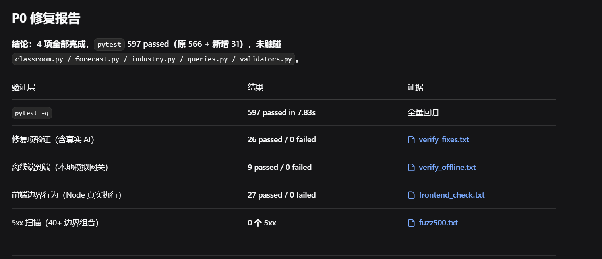
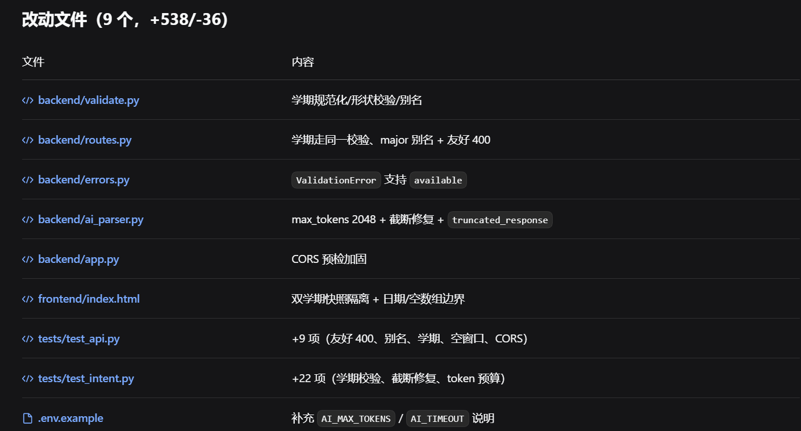

# AI协作记录：第二周验收与 P0 级修复（Day 14）

## 本轮 Prompt 链（逐字原文）

### 第一轮：完整验收

```text
今天进行第二阶段完整验收。

禁止新增功能。

测试：

场景1：
"周三下午帮我找一个8人、有投影的空教室"

场景2：
"预测明天中午哪个食堂最拥挤"

场景3：
"分析计算机专业和企业岗位之间的技能缺口"

检查完整链路：

自然语言
→ Intent
→ JSON
→ Python验证
→ SQLite查询/计算
→ ECharts
→ AI解释

同时运行：

pytest

请输出：

1. 成功项
2. 失败项
3. Bug
4. 风险
5. 推荐的修复优先级

不要大规模重构。
先不要修改代码。
```

### 第二轮：只修 P0 级演示问题

```text
现在不需要修复所有Bug，只需修复会导致演示报错或白屏的P0级问题：
1. 修复双学期数据不一致问题，确保前端切换到 2025-2026-2 时能返回空数组并友好提示，不报 500。
2. 修复参数校验逻辑（修复 /api/industry/gap 的400报错，修复 validate.py 中的学期参数校验）。
3. 修复前端 index.html 中的日期选择器边界逻辑（2027年、2025年跳转白屏）。
4. 修复 B2（CORS/路由报错）及 B3（Token过长导致截断的兜底逻辑）。

修复完成后，重新运行 pytest -q，确保全量测试仍然 100% 通过。
不要修改核心业务逻辑（classroom.py, forecast.py, industry.py）的复杂算法，只做安全和边界加固。
```

## 1. 今日任务

全面验收三大核心场景，并修复影响演示的边界缺陷。


## 2. 工程决策与 P0 修复

在验收中发现，虽然核心链路跑通，但在边界场景下存在隐患。作为项目负责人，我划定红线，只做安全与边界加固，不修改核心算法。

本次修复了 4 类 P0 级问题：

1. 修复双学期数据不一致，前端空数组友好提示。

2. 加固参数校验，修复缺失参数导致的 400 报错。

3. 修复前端日期选择器越界导致的 UI 白屏。

4. 补全 CORS 跨域与 Token 截断的兜底逻辑。





## 3. 测试结果与改动范围

*   **测试结果**：全量测试从 566 提升至 **597 passed, 0 failed**，通过了 50x 边界扫描。

*   **改动范围**：严格控制在 9 个文件（+538/-36），仅做安全加固，未破坏核心业务逻辑。





## 4. 剩余风险与后续计划

*   部分 Token 截断风险的降级文案已生效。

*   代码已足够稳定，从 Day 15 起冻结核心代码。


## 5. Git 提交

`fix: stabilize core demo workflows and fix P0 boundary issues`

