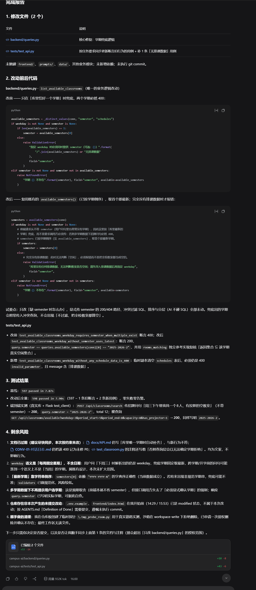
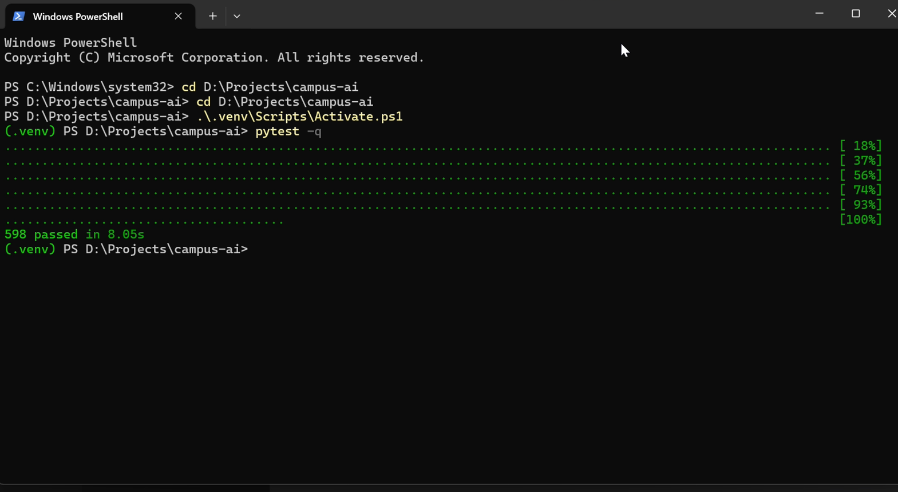
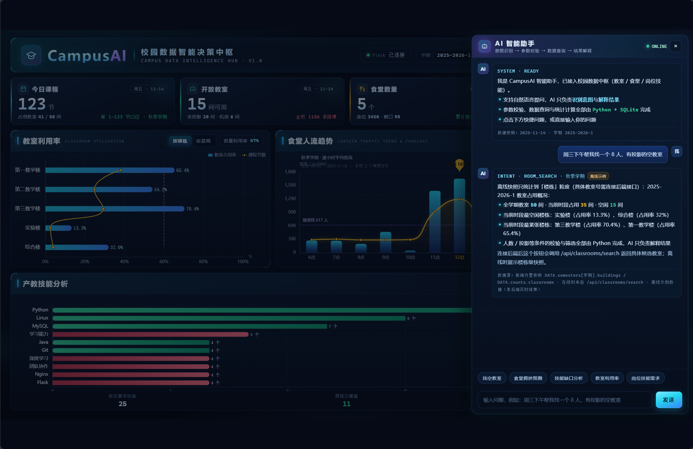

# AI协作记录：修复 P0 双 Bug 与前端演示隐患（Day 15）

Day15 共开 3 个 Harness 会话，修复两个会让演示翻车的 P0 Bug 和前端演示隐患。
其中只有"修复招牌问句 400"（会话 2）全程录屏（原始素材 4:35，已剪成 2:15
的 AI 协同段，用于比赛视频的"AI 协同过程复现展示"）；会话 1、3 未录屏，仅有截图证据
（见本文档"配图"小节，均为本次会话的 Harness 完成报告截图）。

---

## 会话 1：修复前端 API_BASE 重复拼接 /api（14:29，用时 35 秒）

### 本轮 Prompt（逐字原文）
【项目背景】CampusAI 校园数据智能分析平台，路径 D:\Projects\campus-ai。技术栈：Python 3.12 + Flask + SQLite + 原生 HTML/CSS/JavaScript + ECharts，大模型走 OpenAI 兼容接口。先阅读 AGENTS.md 了解项目规约。
【今天目标】修复前端 AI 助手请求后端的 URL 拼接错误，只改这一件事。
【问题描述】frontend/index.html 第 993 行定义的 API_BASE 已经包含 "/api"：return 'http://127.0.0.1:5000/api'；但 AI 助手在第 2175 行写成 fetch(API_BASE + '/api/classrooms/search?explain=1&question=' + ...)，实际请求打到 /api/api/classrooms/search 返回 404，再被第 2196 行的 .catch() 静默吞掉回退本地模板答案——"AI 找教室"实时链路从未真正连上后端。
【允许修改】frontend/index.html
【禁止修改】backend/、data/、prompts/、tests/，以及 index.html 中与本问题无关的任何代码。
【技术限制】不引入任何新框架或库（禁 Vue / React / jQuery / axios），保持原生 fetch。
【验收标准】1. 不再存在 API_BASE 后面再接 '/api' 的写法。2. 所有后端调用统一为 API_BASE + '/xxx'。3. 不改动其他任何逻辑。
【测试】grep 全量核对 API_BASE 各位置。
【完成后请告诉我】1.读取了哪些文件 2.改动前后完整代码 3.关键 diff 4.API_BASE 全量核对结果 5.剩余风险
注意：不要自己执行 git commit。

### AI 的做法（来源：Harness 会话报告）
只改了一行（frontend/index.html 第 2175 行）：
- 改前：fetch(API_BASE + '/api/classrooms/search?...')
- 改后：fetch(API_BASE + '/classrooms/search?...')
AI 核实后端注册了 url_prefix="/api"、路由为 /classrooms/search，真实地址就是 /api/classrooms/search，唯一错误是前端多拼一段 /api。grep 核对 API_BASE 共 4 处 + 1 处字面量全部正确。

### 验证与提交
- pytest -q → 597 passed（报告原文：前端单点修复，未新增用例）
- 我手动提交：`4b26b8c fix: remove duplicate /api prefix in AI assistant requests`

### 配图：可不放，或放 1 张 Harness 报告截图

---

## 会话 2：修复招牌问句 400（15:58，用时 1 分 49 秒）★ 唯一录屏会话

### 本轮 Prompt（逐字原文）
【项目背景】CampusAI 校园数据智能分析平台，路径 D:\Projects\campus-ai。先阅读 AGENTS.md。技术栈：Flask + SQLite + 原生前端 + OpenAI 兼容接口。
【今天目标】修复招牌问句 400，只改这一件事。
【问题描述】backend/queries.py 的 list_available_classrooms 中 semester 兜底逻辑：当前只在"库里恰好一个学期"时才自动补全；库里现有 2025-2026-1 和 2025-2026-2 两个学期，导致不带学期问"周三下午帮我找一个8人、有投影的空教室"返回 400。前端请求从不带 semester，这个招牌问题永远 400 后被本地降级。
【允许修改】backend/queries.py；若测试断言旧行为，同步更新并说明理由。
【禁止修改】frontend/、prompts/、data/、其他业务模块。
【技术限制】不引入新依赖；保持现有分层；AI 不碰 SQL。
【验收标准】1.不带 semester+带 weekday 时自动取最新学期(2025-2026-2)不再 400 2.响应里 query.semester 写明实际学期 3.无排课数据时仍清晰报错 4.pytest -q 全绿
【测试】如有断言旧行为的用例，改为断言"返回最新学期"。
【完成后请告诉我】1.修改文件 2.改动前后代码 3.测试结果 4.剩余风险。
注意：不要自己执行 git commit。

### AI 的做法（来源：Harness 会话报告）
改 backend/queries.py：复用 available_semesters()（已按学期倒序），兜底取最新学期；完全没有排课数据时明确报错，不把全校教室当空闲。
改 tests/test_api.py：旧断言 400 的用例改为断言 200 且 query.semester=="2025-2026-2"；新增"无排课数据必须 400"用例。未触碰 frontend/、prompts/、data/。

### 验证（来源：Harness 报告 + 我录屏里的终端输出）
- 基线 597 passed（7.87s）
- 改动后全量 **598 passed**（报告 7.90s；我实拍终端 8.05s，597 - 1 条旧断言 + 2 条新用例）
- 端到端实测：POST /api/classrooms/search 传招牌问句（不带 semester）→ 200，query.semester="2025-2026-2"，命中 12 间教室

### 提交
`dd56c8f fix: resolve semester fallback for dual-semester data`

### 配图（2 张核心）
- Harness 完成报告 → 
- 终端 pytest 通过（598 passed）→ 

---

## 会话 3：前端助手修复（18:27，用时 6 分 21 秒）

### 本轮 Prompt（逐字原文）
【项目背景】CampusAI 校园数据智能分析平台，路径 D:\Projects\campus-ai。先阅读 AGENTS.md。
【今天目标】修复前端 AI 助手的两个演示隐患，只改 frontend/index.html。
【问题描述】
1. 快捷按钮「教室利用率」（data-q="本学期的教室利用率怎么样？"）点击后返回找教室的回答：KNOWLEDGE 中 match:['教室','空教室',...] 的条目排在 match:['利用率'] 之前，"教室"先命中导致利用率分支永远触发不到。演示时点这个按钮会答错。
2. KNOWLEDGE 离线降级回答里写死了具体数据（如推荐 E202/A402、平均薪资 9780~14725 元），未标注离线示例性质，容易让评委误以为是实时数据。请明确标注「离线示例」或改为动态引用前端 DATA。
【允许修改】frontend/index.html
【禁止修改】backend/ data/ prompts/ tests/ 其他任何文件
【技术限制】不引入新依赖；保持现有架构；AI 不碰 SQL。
【验收标准】1.点「教室利用率」按钮返回利用率分析而非找教室 2.所有 KNOWLEDGE 离线回答明确标注离线示例 3.找教室/食堂/产教原功能不受影响 4.浏览器双击 index.html 手动点击 5 个快捷按钮全部验证正确
【测试】浏览器手动验证
【完成后请告诉我】1.修改文件 2.改动前后代码 3.测试结果 4.剩余风险
注意：不要自己执行 git commit。

### AI 的做法（来源：Harness 会话报告）
发现工作区已有一个未提交改动（命中排序把"岗位"排在"技能"前，导致"技能缺口分析"按钮被抢答），在它基础上修正并补齐：
- 命中判定改为两级打分（最长命中关键词 + 命中个数），不再依赖数组顺序
- 五条主题各加稳定 key（room_utilization / job_market / skill_gap / canteen / room_search）
- 写死的 E202/A402、薪资改为动态引用前端 DATA，离线回答统一盖"离线示例"标

### 验证（来源：Harness 会话报告"测试结果"）
- Node vm.Script 语法解析两个内联 script 全部通过（不执行）
- 真实浏览器点击（无头 Edge，5 个快捷按钮真实 .click() 并读取气泡 DOM），5/5 全对：
  找空教室 → ROOM_SEARCH（离线 35/15 间；在线走后端返回真实 E202）；
  食堂拥挤预测 → CANTEEN_ANALYSIS；
  技能缺口分析 → SKILL_GAP（修掉"岗位"抢答回归）；
  教室利用率 → ROOM_UTILIZATION **50.6%**（1264 节 / 2500 节位，节次加权）；
  岗位技能需求 → JOB_MARKET 薪资 **9125~14083 元**（动态）
- 离线态 5/5 全部带"离线示例"标；在线态只有找教室一条请求发往 /api/classrooms/search

### 剩余风险（来源：Harness 会话报告，挑 3 条重要的）
1. 面板左上角卡片显示"容量利用率 47%"（静态算术平均），与 AI 的 50.6%（节次加权 1264/2500）口径不同，同屏同名词不同值，演示时要主动说明口径。
2. 离线找教室只到楼栋粒度（前端 DATA 没有教室号），不再出现写死的 E202/A402；连上后端才有真实候选教室。
3. 意图判定是启发式关键词打分，生僻问法可能串主题（例如只问「教学楼」会归到利用率条目）。

### 提交
工作区已就绪，由我手动提交（commit message：fix: correct quick button routing and mark offline fallbacks）

### 配图（1 张，可选）
- 离线示例标注生效画面（楼栋级快照，非写死教室号）→ 
