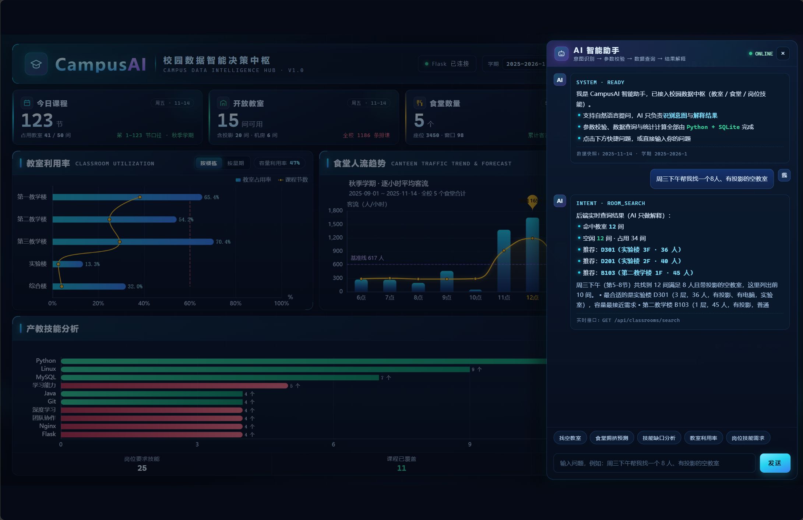
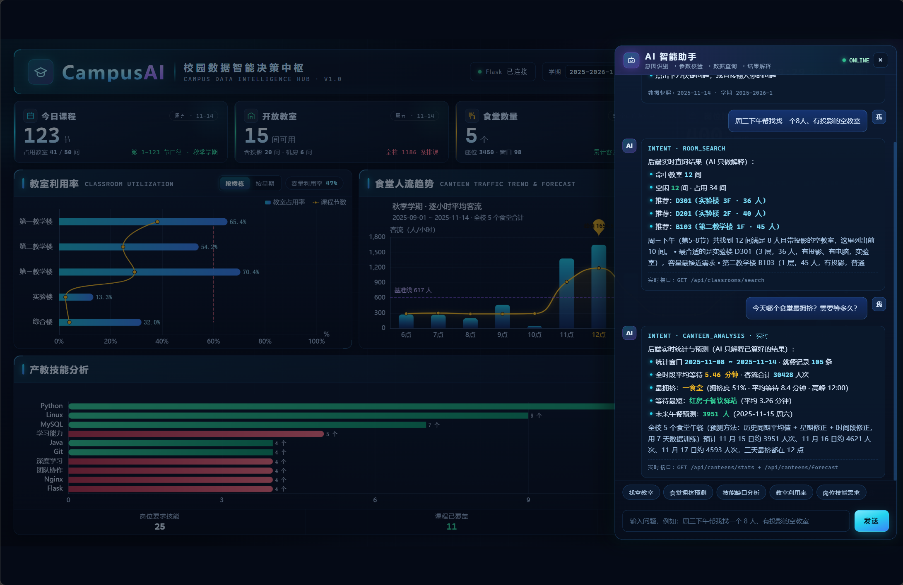
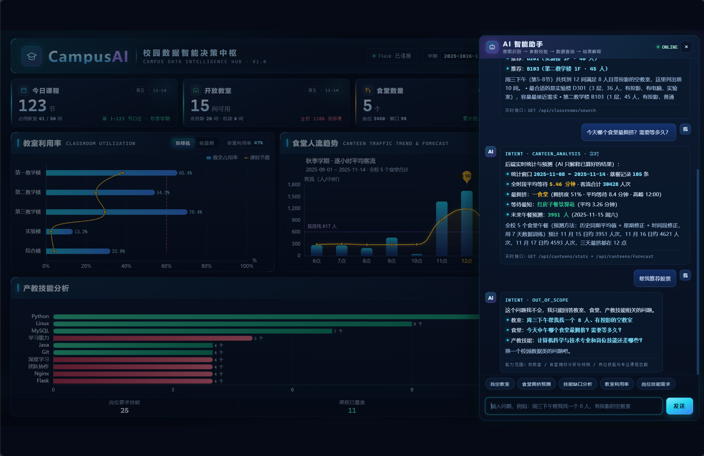
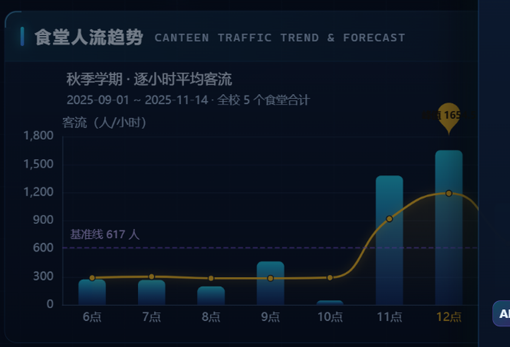
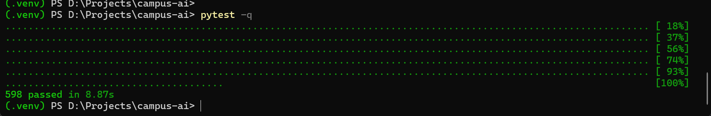

# Day16 · 稳定性检查：修在线降级、快捷按钮实时化与图表可读性

Day16 共开 2 个 Harness 会话，做完演示前最关键的稳定性检查：
第一个会话修"后端在线但 AI 助手永远回离线示例"的降级问题，第二个会话修大屏图表文字看不清的问题。
两轮都是**我先在真机上复现现象 → AI 定位根因 → 我拍板改法 → AI 只改 frontend/index.html → 我再用真实浏览器验收**，
正是赛道 2.1 要求的「意图主导、AI 生成代码」的完整闭环。

最终状态：`git status` 全仓库只有 `frontend/index.html` 被改动（两轮合计约 +443 / -100），
`backend/`、`prompts/`、`tests/`、`data/` 全部 unchanged，未提交（commit 由我手动执行）。

---

## 会话 1：修复在线降级与快捷按钮实时化（19:31，用时 14 分 59 秒）

### 1. 本轮 Prompt（逐字原文）

```text
Harness，帮我把前端 AI 助手的问题修一下，这是我自己实测发现的，不是瞎猜的。

先说现象：我把后端跑起来、页面显示"已连接"，但只要在 AI 助手那边问找教室的问题，比如"周三下午帮我找一个8人、有投影的空教室"，或者"下周三下午找教室"，回答全是"离线示例"，从来没有返回过真实的教室。我看了浏览器网络面板，请求 /api/classrooms/search 是被中断的状态。我直接测后端是正常的，这个接口要 4 到 5 秒才返回，因为它要调大模型做意图识别和结果解释。问题出在 frontend/index.html：给这个请求设了 2600 毫秒就中断，后端还没返回就被前端掐断了，所以每次都走降级。

请你做这几件事：
1. 把找教室请求的超时从 2600 毫秒改成 15 秒，保留现有的加载提示，别让用户以为页面卡了。
2. 顺带检查 apiGet 函数（大概在 1043 行）和它各处调用，凡是会调含 AI 解释的接口，超时都放宽到 15 秒以上。
3. 还有一个问题：快捷按钮里除了找教室，其他四个（食堂拥挤预测、技能缺口分析、教室利用率、岗位技能需求）即使后端在线，也返回的是页面内置的离线快照，没有走实时接口。我希望在线时它们调后端的实时数据（食堂用 /api/canteens/ 那几个接口，技能用 /api/industry/gap），只有后端连不上或者请求失败才用本地快照，"离线示例"的标注保留。
4. 另外：输入"帮我推荐股票""天气怎么样"这种无关问题，现在会返回一段校园介绍，我希望它明确说"这个问题我不会，我只能回答教室、食堂、产教技能相关的问题"，别答非所问。

约束：只改 frontend/index.html 和它引用的东西，不要动 backend 和 prompts 里的内容，classroom.py、forecast.py、industry.py 这三个核心文件更不能动。别引入新框架，保持原生 fetch。改完自己把页面打开验证一遍，跑一下 pytest，然后告诉我：改了哪些地方、每个问题怎么修的、浏览器验证结果、pytest 结果、还有没有没修干净的。不要自己 git commit。
```

### 2. Agent 的回复（原文关键段）

> 只动了一个文件：`campus-ai/frontend/index.html`（+395 / -64 行，2760 行）。git status 只有 `M frontend/index.html`；backend/classroom.py、backend/forecast.py、backend/industry.py、整个 prompts/ 全部 unchanged；没有引入任何框架（还是原生 fetch），没有 commit。

问题 1（找教室 2600ms 被掐断）：
> 根因确认：实测 /api/classrooms/search 对「周三下午帮我找一个8人、有投影的空教室」耗时 3.3-5.7 秒（要走大模型做意图识别 + 结果解释），而前端写死 2600ms abort，必然每次落入 catch → localAnswer() 的降级分支。我实测也复现了旧的 abort 现象。改法：新增 `AI_TIMEOUT_MS = 15000`，找教室改由 `fetchRoomSearch()` 发起，超时 15s；顺手把它从「裸 fetch + 手写 setTimeout」收敛到统一的 `apiGetEx`（同一个 AbortController 逻辑，且能拿到后端错误码）。加载提示保留并加强：原来的三个跳动点不动，另加 `setTypingHint()` 补一行「正在调用后端实时接口（AI 意图识别 + 结果解释约 4~5 秒）…」。

问题 2（apiGet 及各调用点超时）：
> apiGet 默认值 `timeoutMs || 2500` → `timeoutMs || AI_TIMEOUT_MS (15s)`；/industry/gap 3000→15000；/canteens/trend 3500→15000；/meta/semesters 2000→PROBE_TIMEOUT_MS=2500（纯元信息、不吃大模型、决定右上角「已连接/离线快照」的探测，给 15s 会让"后端没起来"时页面愣 15 秒才显示离线，反而像卡死）。新增 `ensureOnline()`：提问时若 apiOnline 还是 false，就按需再轻探一次（2.5s），探到就转在线并刷新角标，探不到才走快照。

问题 3（四个快捷按钮不走实时接口）：
> 根因确认：`ask()` 里那句 `useBackend = apiOnline && (!localHit || localHit.key === 'room_search')`——只要问题命中了食堂/技能/岗位/利用率的知识库条目，useBackend 直接为 false，无论后端在不在线都走内置快照。改法：按命中的主题分别打真实接口：食堂拥挤预测 → /api/canteens/stats + /api/canteens/forecast（2 个并发）；技能缺口分析 → /api/industry/gap；岗位技能需求 → /api/industry/skills + /api/industry/gap（2 个并发）；教室利用率 → /api/classrooms/available。只有「后端连不上」或「该主题的接口全部失败」才回落 localAnswer()，「离线示例」徽标逻辑原样保留。所有在线回答只做「接口字段 → 展示文案」，不做业务计算，并各自带「实时接口: GET …」来源署名。

问题 4（无关问题答非所问）：
> 根因确认：实测「帮我推荐股票」「天气怎么样」后端返回 400 unsupported_intent，旧代码一句 .catch() 把它和「网络断了」一起吞了 → localAnswer() → INTENT · GENERAL 那段校园介绍。改法：apiGetEx 把后端错误码透出来，fetchRoomSearch 见到 unsupported_intent 就调 `unsupportedAnswer()`，文案就是「这个问题我不会，我只能回答教室、食堂、产教技能相关的问题。」；localAnswer() 不再吐校园介绍：命中主题用对应快照；没命中但句子里还有校园线索就用找教室快照；否则明确拒答。这条回答不含数据，所以不打「离线示例」徽标（它本来就不是离线数据）。

### 3. 发现的具体问题（改前，均能落到文件行号）

| 问题 | 位置 | 现象 |
|---|---|---|
| 找教室请求 2600ms 就被 abort | `frontend/index.html` L2272-2275（fetch + 手写 setTimeout） | 后端 AI 链路 4~5s > 前端超时 → 每次落 catch 降级 → 永远"离线示例" |
| apiGet 默认超时 2500ms 偏短 | L1043-1055（`timeoutMs \|\| 2500`） | /industry/gap、/canteens/trend 等含 AI 解释的调用同样会被掐断 |
| 快捷按钮不走实时接口 | L2270（`useBackend = apiOnline && (!localHit \|\| localHit.key === 'room_search')`） | 命中知识库主题即 useBackend=false，在线也不调后端 |
| 无关问题答非所问 | L2270 附近 .catch() | 400 unsupported_intent 被当网络错误吞掉 → 回校园介绍 |

### 4. 关键 diff（改前 → 改后）

```js
// 超时：统一收敛到 apiGetEx + AI_TIMEOUT_MS
-    var timer = setTimeout(function () { if (ctrl) { ctrl.abort(); } }, timeoutMs || 2500);
+    var AI_TIMEOUT_MS = 15000;      // 含 AI 意图识别/结果解释的接口
+    var PROBE_TIMEOUT_MS = 2500;    // 纯元信息健康探测，保持短超时
+    var timer = setTimeout(function () { if (ctrl) { ctrl.abort(); } }, timeoutMs || AI_TIMEOUT_MS);

// 找教室：写死 2600ms 的裸 fetch → apiGetEx，且区分"后端明确拒答"和"真的连不上"
+  function fetchRoomSearch(text, onLive, onUnsupported, onFail) {
+    apiGetEx('/classrooms/search?explain=1&question=' + encodeURIComponent(text), AI_TIMEOUT_MS, function (d, info) {
+      if (d && d.summary) { onLive(roomSearchAnswer(d)); return; }
+      if (info && info.code === 'unsupported_intent') { onUnsupported(); return; }
+      onFail();
+    });
+  }

// ask()：useBackend 判定删除，改为 ensureOnline() + 按命中主题路由到实时接口
-    var useBackend = apiOnline && (!localHit || localHit.key === 'room_search');
-    if (useBackend) { ... 裸 fetch + 2600ms ... }
+    ensureOnline(function (online) {
+      if (!online) { offline(); return; }
+      if (!hit || hit.key === 'room_search') {
+        fetchRoomSearch(text, done, function () { done(unsupportedAnswer()); }, offline);
+        return;
+      }
+      // hit.key 分别走 fetchCanteenLive / fetchSkillGapLive / fetchJobMarketLive / fetchRoomUtilizationLive
+    });

// 无关问题明确拒答（新增）
+  function unsupportedAnswer() {
+    return { local: true, text: '这个问题我不会，我只能回答教室、食堂、产教技能相关的问题。…' };
+  }
```

### 5. 真实验证结果（我的浏览器实测，非只看报告）

- pytest（.venv）：**598 passed in 8.87s**（报告 598 passed，一致）
- 找教室「周三下午帮我找一个8人、有投影的空教室」→ **命中 12 间**，推荐 D301 / D201 / B103，回答标注「实时接口: GET /api/classrooms/search」，不再是离线示例
- 「帮我推荐股票」→ **「这个问题我不会，我只能回答教室、食堂、产教技能相关的问题。」**（INTENT · OUT_OF_SCOPE）
- 快捷按钮「食堂拥挤预测」→ 实时数据：一食堂最挤（拥挤度 51% · 平均等待 8.4 分钟），未来午餐预测 3951 人，标注「实时接口: GET /api/canteens/stats + /api/canteens/forecast」
- 网络面板：/api/ 请求被中断数 = 0（旧代码此处必为 ERR_ABORTED）

- 找教室实时回答（命中 12 间，推荐 D301/D201/B103，标注实时接口）→ 
- 食堂拥挤预测实时数据（一食堂最挤：拥挤度 51% · 平均等待 5.46 分钟，午餐预测 3951 人）→ 
- 无关问题明确拒答（INTENT · OUT_OF_SCOPE）→ 

---

## 会话 2：图表文字可读性（19:53，用时 12 分 19 秒）

### 1. 本轮 Prompt（逐字原文）

```text
Harness，还有个 UI 问题要你修。我截图看了大屏，食堂人流趋势图左上角那行说明文字（"秋季学期·逐小时平均客流"和下面那行日期"2025-09-01 ~ 2025-11-14 · 全校 5 个食堂合计"）小得几乎看不清，放到投影上更没法看。我查了一下，图表里的标题、副标题、坐标轴名字、图例基本都是 11 到 12 号字，颜色还是灰蓝色（#5f7899、#8fa6c4），在深色背景上对比度很低。而且不止这一处，其它图表也一样：教室利用率图、周趋势图、产教技能图的标题、图例、坐标轴名字，还有底部"岗位要求技能/课程已覆盖/技能缺口"那一排标签（11.5px 还是最暗色），全是同样的问题。

请你统一把说明性文字放大提亮，标准大概这样：
1. 图表标题 16 号，副标题 13~14 号，颜色至少用 #a8c1e0 这个亮度的，别再出现 #5f7899 这种暗色。
2. 图例和坐标轴刻度 13~14 号，颜色用 #8fa6c4 或更亮。
3. 坐标轴名字（客流（人/小时）、等待（分钟）、需求岗位数这些）14 号，颜色提亮。
4. 底部统计条的标签（岗位要求技能这些）从 11.5px 提到 13px，颜色从最暗的提到 #8fa6c4。
5. 注意字号大了别把图表撑破，改完检查布局，特别是食堂图副标题那两行，别出现截断。

只改 frontend/index.html，不要动别的文件。改完自己打开页面把三个图表都截图看看，确认没有文字被截断或者挤在一起，然后跑一下 pytest。告诉我改了哪些字号和颜色、验证结果、有没有剩余问题。不要自己 git commit。
```

### 2. Agent 的回复（原文关键段）

> 只动 `frontend/index.html`（2772 行）。下面「修复后」一列是用 CDP 读 ECharts getOption() 拿到的真实生效值，不是照着代码猜的。

| 元素 | 修复前 | 修复后 |
|---|---|---|
| 图表标题（食堂逐小时/周趋势） | 12px #9fb8d4 | 16px #dbe9fb |
| 图表副标题（那两行日期） | 11px #5f7899 等宽 | 13px #a8c1e0 |
| 面板副标题 .panel-head .en | 11px #4d7099（比 #5f7899 还暗） | 13px #a8c1e0 |
| 图例（3 张图） | 12px #8fa6c4 | 13.5px #a8c1e0 |
| 坐标轴刻度 | 12px #8fa6c4（产教 y 轴 13px） | 13.5px #a8c1e0（类目轴名 14px #dbe9fb） |
| 坐标轴名字（客流（人/小时）等） | 11-12px #5f7899 | 14px #a8c1e0 |
| 底部统计条标签 | 11.5px #5f7899 | 13px #8fa6c4 |
| 图内批注（基准线等） | 11px | 12.5px（保留语义色） |
| 数据标签（65.4%、14个 等） | 11-13px | 未改——数据值不是说明文字 |

> 实现方式：把 THEME 里原来两个暗色 token 合成一个 `label: '#a8c1e0'`（dim/faint 已彻底删掉，图表代码里 #5f7899 一个不剩）；CSS 侧改了 .panel-head .en、.gap-strip .k、--text-faint。

> 为了"放大后不撑破"必须一起调的三处布局：
> 1. 食堂分时段图：grid.top 58→86、两道 y 轴 nameGap 16→8。原来「客流（人/小时）」「等待（分钟）」正好压在副标题那一行上。
> 2. 食堂按周趋势图：grid.right 34→64、top→86，y 轴名加 align:'left'。原来最后一个刻度「预测 07-18 周六」被画布右边缘截断，「人/天」横向压在「9,000」上。
> 3. 产教技能图：grid.top 34→40、bottom 12→34。原来底部刻度 0/3/6/9/12/15 和轴名「需求岗位数」被画布下边缘切掉一半。

> 验证：真浏览器（headless Edge + CDP，加载真 ECharts）把三个图表 5 种视图各截 2x 图，再对三处拥挤位置截 3x 放大图——放大后无一处文字被截断、无一处互相压字；面板头无溢出；底部统计条标签 13px 高 16px，条高 53px 不溢出；「按星期」视图里 101.6%/102.4%/105.6% 这些超 100% 的柱标签都在画布内。pytest：598 passed in 7.81s。

### 3. 发现的具体问题（改前，均能落到文件行号）

| 问题 | 位置 | 现象 |
|---|---|---|
| 食堂图标题/副标题过小过暗 | `canteenHourOption()` L1415-1416（title 12px #9fb8d4 / subtext 11px #5f7899） | 你红线框住的两行说明文字，投影上几乎看不清 |
| 轴名与副标题重叠 | 食堂分时段图 grid.top=58 + nameGap=16 | 「客流（人/小时）」压在日期副标题那一行上 |
| 周趋势图刻度被截断 | `canteenWeekOption()` grid.right=34 | 最后一个预测日期刻度被画布右边缘切掉 |
| 产教图底部刻度被切 | `skillOption()` grid.bottom=12 | 刻度 0/3/6/9/12/15 与「需求岗位数」被下边缘切掉一半 |
| 底部统计条标签偏小偏暗 | `.gap-strip .k`（11.5px var(--text-faint)） | 「岗位要求技能/课程已覆盖/技能缺口」暗色小字 |
| 面板英文副标题过暗 | `.panel-head .en`（11px #4d7099） | 比 #5f7899 还暗，几乎不可见 |

### 4. 关键 diff（改前 → 改后）

```js
// THEME：dim/faint 两个暗色 token 合并为一个提亮后的 label
   THEME = {
-    dim: '#8fa6c4',
-    faint: '#5f7899',
+    label: '#a8c1e0',
   };

// 食堂图标题/副标题（周趋势图同）
   title: {
-    textStyle: { color: '#9fb8d4', fontSize: 12, fontWeight: 'normal' },
-    subtextStyle: { color: '#5f7899', fontSize: 11, fontFamily: 'monospace' }
+    textStyle: { color: '#dbe9fb', fontSize: 16, fontWeight: 'normal' },
+    subtextStyle: { color: '#a8c1e0', fontSize: 13 }
   },

// 食堂分时段图布局：轴名不再压副标题
-    grid: { left: 66, right: 108, top: 58, bottom: 42 },
-    nameTextStyle: { color: THEME.faint, fontSize: 11, align: 'left' },
+    grid: { left: 66, right: 108, top: 86, bottom: 42 },
+    nameTextStyle: { color: THEME.label, fontSize: 14, align: 'left' },
```

### 5. 真实验证结果（我的浏览器实测）

- pytest（.venv）：**598 passed**（我实测 8.43s；报告 7.81s，一致）
- 打开页面实测食堂图：标题「秋季学期·逐小时平均客流」与副标题日期清晰独立成行，与「客流（人/小时）」轴名不再重叠、无截断
- 代码核对：`label: '#a8c1e0'` 已生效，title 16px / subtext 13px / 图例与刻度 13.5px / 轴名 14px / `.gap-strip .k` 13px，旧暗色 token 在图表代码中已清除

- 食堂人流趋势图左上角标题/副标题清晰独立成行（不再压轴名、无截断）→ 

---

## 6. 改动文件汇总

只改了 `frontend/index.html`（git status 确认，无其他文件）。

| 会话 | 改动量 | 内容 |
|---|---|---|
| 会话 1 | +395 / -64 | 在线降级修复、apiGetEx 统一超时、快捷按钮实时接口、无关问题拒答 |
| 会话 2 | +48 / -36 | 图表文字放大提亮、三处布局防重叠 |

验证脚本（浏览器检查、CDP 审计等）放在项目外的 `_campus_check/`，不污染仓库。

## 7. 剩余风险（来源：Agent 报告，挑重要的）

1. 「教室利用率」卡片 47%（静态算术平均）与 AI 实时口径不同，演示时要主动说明口径。
2. 「配置上限 60%」标注改动前后都看不到：它挂在一条"用来画竖线的 line 系列"上的 label，position:'end' 端点落在图外/被柱子压住（Agent 给了 markLine 修法，未实施，属结构改动）。
3. 食堂「按周趋势」第一个数据标签 8501 与最高位刻度 9000 有轻微重叠（数据标签定位问题，未动）。
4. 峰值图钉「峰值 1655」偏小、在 44px 图钉里略显溢出（数据标记，未动）。
5. 非图表处还有几处偏小说明文字未动（卡片角标「周五·11-14」11.5px、AI 抽屉文字、控件标签 12px）；其中控件标签颜色已随 --text-faint 提亮。
6. 右侧收起的 AI 抽屉在非 16:9 窗口下会露出 55px（1920×1080 时为 0px，只有窗口偏矮时才出现，预置问题与本次改动无关）。
7. 意图判定是启发式关键词打分，生僻问法可能串主题（既有限制，未扩大）。
8. 离线时每次提问会多一次 /meta/semesters 轻探（约 0.6s），换来后端中途恢复后不用刷新页面就能转回在线。

## 8. 验证截图清单（均已在 images/ 目录）

| 文件名（docs/ai-collaboration/images/） | 内容 | 用途 |
|---|---|---|
| `day16-room-search-live.png` | AI 助手回答"周三下午 8人+投影"，命中 12 间、标注实时接口 | 会话 1 验收证据 |
| `day16-canteen-live.png` | 快捷按钮「食堂拥挤预测」返回实时数据（一食堂 51%、预测 3951 人） | 会话 1 验收证据 |
| `day16-out-of-scope.png` | 输入"帮我推荐股票"的明确拒答 | 会话 1 验收证据 |
| `day16-readability-after.png` | 食堂人流趋势图左上角标题/副标题清晰画面 | 会话 2 验收证据 |
| `day16-pytest-passed.png` | 终端 pytest 598 passed | 两轮通用 |

- 终端 pytest 实拍（598 passed in 8.87s）→ 

> 配图说明：正文以上面的文字与代码块为准，截图只作辅助证据（README 规范）。
> 截图前已启动后端（127.0.0.1:5000），页面为真实浏览器渲染；pytest 在项目 .venv 环境运行。
