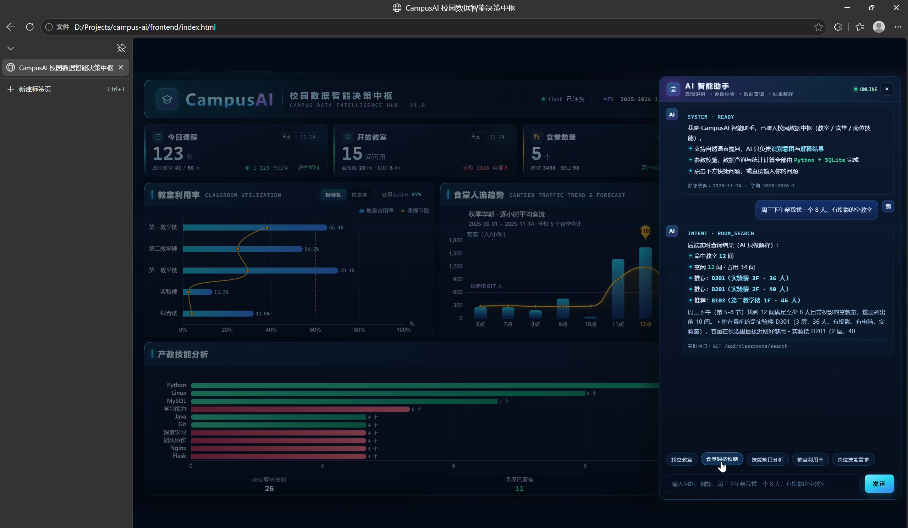
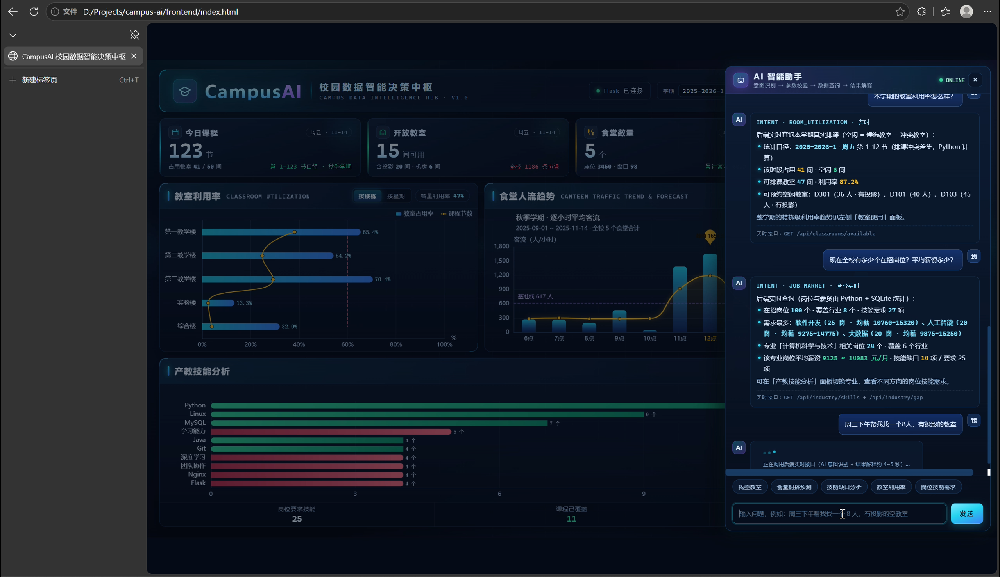
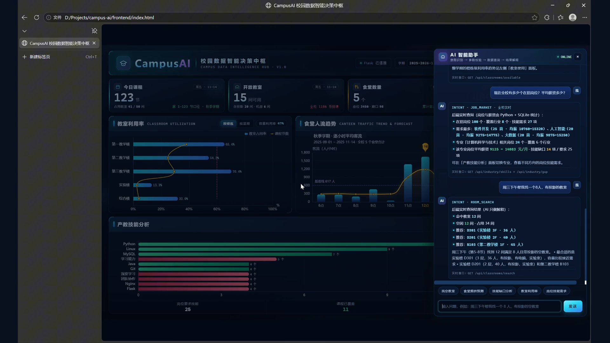
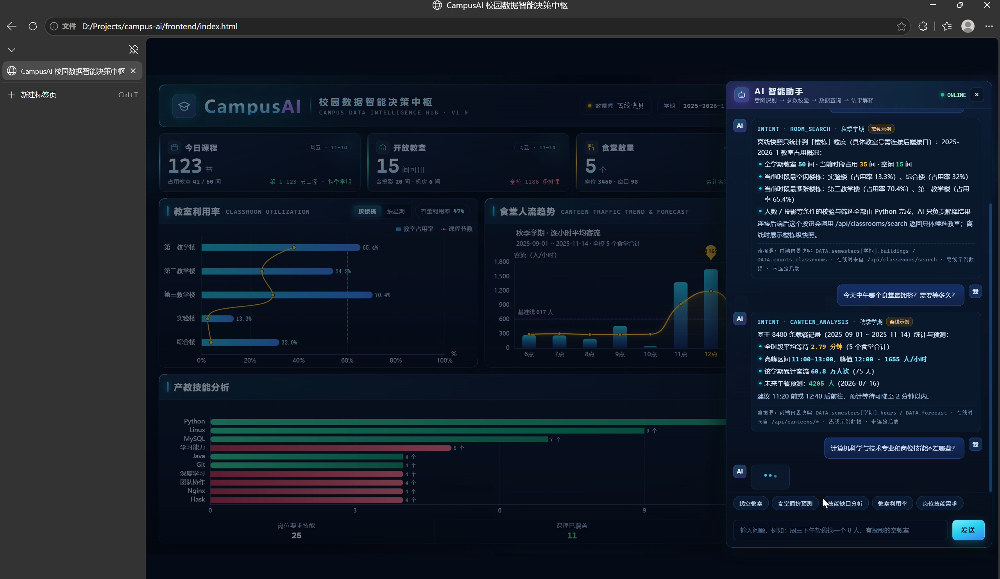
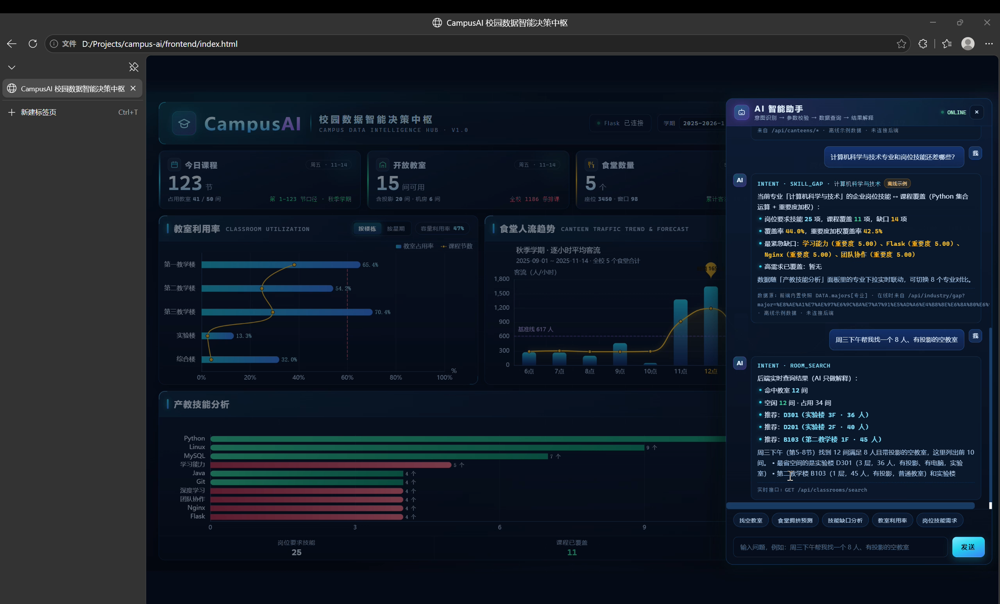

# Day17 · Demo 复核 + 演示视频制作（两版成片）

今天按 Day16 结尾的计划走：**人工验证日**，没有开 Harness 会话、没有代码改动。

做的事就两件：把 5 个快捷按钮和手输一句话在真机上逐个点了一遍，确认**在线**和**后端断开**两种状态下表现都符合预期；顺手把整个演示过程录了屏，用剪映剪成演示视频，留给比赛视频用。

---

## 1. 在线复核（5 按钮 + 手输一句话）

后端跑起来（PowerShell 里 `backend/app.py`），浏览器打开 `frontend/index.html`，右上角显示「Flask 已连接」。逐个点 5 个快捷按钮，再手输一句话，结果全部走**实时接口**：

| 操作 | 实测返回 |
|---|---|
| 找空教室 | 命中 **12 间**；推荐 D301（实验楼3F·36人）、D201（实验楼2F·40人）、B103（第二教学楼1F·45人）；标注「实时接口: GET /api/classrooms/search」 |
| 食堂拥挤预测 | 一食堂最挤（拥挤度 51% · 平均等待 8.4 分钟），未来午餐预测 **3951 人**；标注「实时接口: GET /api/canteens/stats + /api/canteens/forecast」 |
| 技能缺口分析 | 岗位要求技能 **25 项**、课程覆盖 11 项、缺口 14 项，覆盖率 44.0%（重要度加权 42.5%）；最紧急缺口：学习能力 / Flask / MySQL / 团队协作（重要度 5.00） |
| 教室利用率 | 该时段占用 **41 间**、空闲 6 间、可排课 47 间、利用率 **87.2%**；可预约 D301 / D101 / D103；标注「实时接口: GET /api/classrooms/available」 |
| 岗位技能需求 | 在招岗位 **100 个**、覆盖 8 个行业、27 项技能；软件开发 25 岗（均薪 10760~15320）、人工智能 20 岗（9275~14775）、大数据 20 岗（9875~15250）；计科相关 24 岗（9125~14083 元/月，缺口 14/要求 25） |
| 手输「周三下午帮我找一个8人，有投影的教室」 | 命中 **12 间**、空闲 12 间、占用 34 间，推荐同上；有「正在调用后端实时接口（AI 意图识别 + 结果解释约 4~5 秒）…」加载提示 |

5 个按钮 + 手输一句话全部返回实时数据，**没有一次掉到离线示例**，Day16 修的在线降级问题在真机上稳定。

## 2. 断网复核（离线示例）

停掉后端（关掉 `app.py`），再点 demo：

- 右上角从「Flask 已连接」变成「数据源 离线快照」，回答带「离线示例」徽标 + 「未连接后端」
- 找空教室 → 楼栋级快照：全学期 50 间、当前时段占用 35 间、空闲 15 间；最空闲实验楼（13.3%）、综合楼（32%）；最紧张第三教学楼（70.4%）、第一教学楼（65.4%）
- 食堂拥挤预测 → 基于 **8480 条**就餐记录：全时段平均等待 2.79 分钟、峰值 12:00（1655 人/小时）、累计客流 60.8 万人次、未来午餐预测 **4205 人**（2026-07-16）、建议 11:20 前或 12:40 后前往
- 技能缺口分析 → 缺口 14 项、覆盖率 44.0%（加权 42.5%），最紧急 Flask / Nginx / 团队协作（重要度 5.00）
- 重新拉起后端 → 页面**自动转回在线**（「后端恢复 → 数据重新实时化」），不用刷新页面

结论：在线/离线两条路径都符合 Day16 修完后的预期，**没发现新问题**。

## 3. 验证截图

- 在线找空教室（实时命中 12 间，底部字幕「① 找空教室 | 实时命中12间·推荐D301/D201/B103」）→ 
- 教室利用率（87.2%）+ 岗位市场（100 个岗位）实时回答，手输一句话正在调用后端 → 
- 手输「周三下午帮我找一个8人，有投影的教室」完整回答（命中 12 间，标注实时接口）→ 
- 断网后离线示例（找教室楼栋快照 + 食堂 8480 条记录，「离线示例 · 未连接后端」）→ 
- 重新拉起后端，自动转回在线（「后端恢复 → 数据重新实时化」）→ 

> 正文以上述文字为准，截图只作辅助证据。