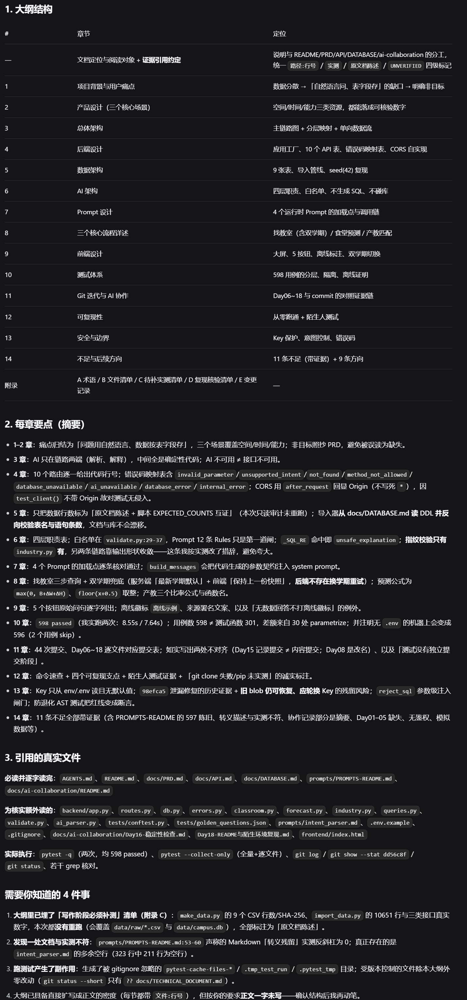
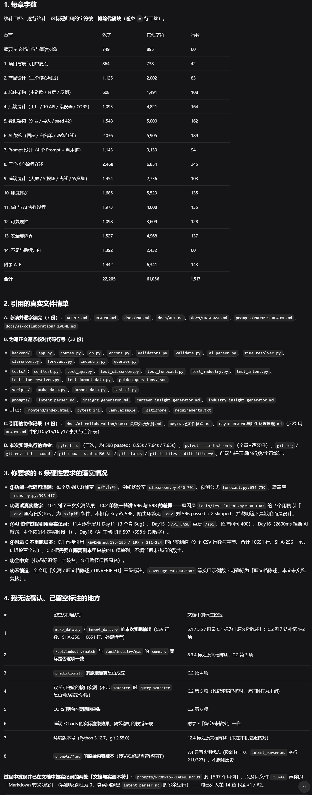
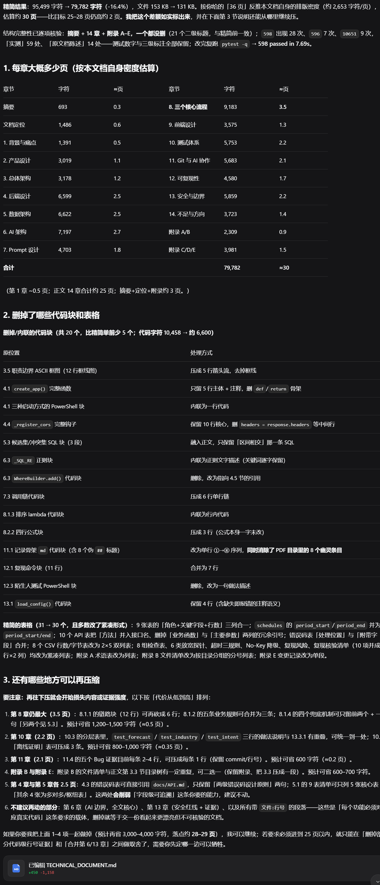
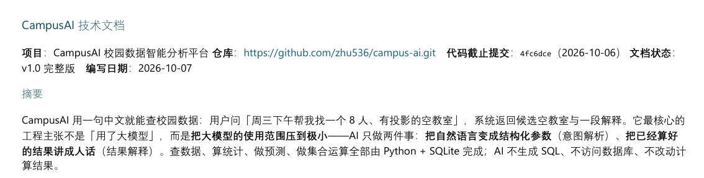

# Day19 · 技术文档撰写（三轮 Prompt + PDF 交付）

> 日期：2026-10-07　主题：写技术文档（Day06~19 过程沉淀，交付 ≤30 页 PDF）
> 协作方式：Harness 写内容（大纲 → 正文 → 精简），人工负责审核与 PDF 转换交付
> 记录核验来源：① Harness 三轮报告截图（本轮完整细节）② 本地会话摘要（C:\Users\Zqy\.dsh\storages\session_projcache\sessions\session-ae713630，确认 3 轮、314/1517 行、36 页、-16.4% 等关键数字）③ 项目文件实测（TECHNICAL_DOCUMENT.md 当前 837 行 / 128.1 KB）

---

## 1. 本轮 Prompt（逐字原文）

### 1.1 第一轮 · 出大纲（4 分 10 秒）

```
帮我给项目 D:\Projects\campus-ai 写一份技术文档的大纲，先给我看，别直接写全文。

写之前先读 AGENTS.md、docs/PRD.md、docs/API.md、docs/DATABASE.md、README.md、prompts/PROMPTS-README.md、docs/ai-collaboration/README.md，搞清楚项目再写。

大纲要覆盖这 14 块：
1. 项目背景与用户痛点
2. 产品设计（三个核心场景）
3. 总体架构：用户 → Intent 解析 → 参数校验 → Python 查询/计算 → SQLite → ECharts → AI 解释
4. 后端设计：Flask 应用工厂、10 个 API、统一 JSON 错误处理（400/404/405/500/503）、CORS 自实现
5. 数据架构：9 张表、CSV → SQLite 导入、random.seed(42) 复现
6. AI 架构：四层职责划分、意图白名单、AI 不生成 SQL、AI 不直接访问数据库
7. Prompt 设计：prompts/ 下 4 个运行时 Prompt 各自职责与调用链
8. 三个核心流程详述：AI 找教室（含双学期兜底）、食堂预测（历史平均+星期修正+时段修正）、产教技能匹配（Python 计算覆盖率，AI 只解释）
9. 前端设计：大屏、5 个快捷按钮、离线降级标注、双学期切换
10. 测试体系：598 个用例怎么分层（单元/接口/端到端）
11. Git 迭代与 AI 协作过程：docs/ai-collaboration/ 里 Day06~18 的记录怎么证明开发过程
12. 可复现性：陌生环境从零跑通（README 已验证）
13. 安全与边界：API Key 保护、意图控制、错误码约定
14. 不足与后续方向

硬性要求：
1. 别编测试结果、性能指标、不存在的功能，所有数字以代码和测试为准
2. 只新建 docs/TECHNICAL_DOCUMENT.md 一个文件（大纲版），其他文件一律不动
3. 写完后告诉我：1.大纲结构 2.每章要点 3.你引用了哪些真实文件
4. 不要执行 git commit
```

**Agent 回复关键段**（原文引用，18:29 发出，用时 4 分 10 秒）：

> 已完成：只新建了 docs/TECHNICAL_DOCUMENT.md（314 行，大纲版），其他受版本控制文件一律未动，未执行 git commit。
>
> 1. 大纲结构：文档定位与阅读对象 + 证据引用约定（路径:行号 / 实测 / 原文档陈述 / UNVERIFIED 四级标记），14 章 + 附录 A-E。第 3 章「AI 只在链路两端（解析、解释），中间全是确定性代码；AI 不可用 ≠ 接口不可用」；第 6 章「四层职责表；白名单在 validate.py:29-37，Prompt 12 条 Rules 只是第一道闸；_SQL_RE 命中即 unsafe_explanation；指纹校验只有 industry.py 有，另两条链路靠输出形状收敛——这条我按实测改了措辞，避免夸大」；第 10 章「598 passed（我实测两次：8.55s / 7.64s）；用例数 598 ≠ 测试函数 301，差额来自 30 处 parametrize；无 .env 的机器上会变 596（2 个用例 skip）」；第 11 章「44 次提交、Day06~18 逐文件对应提交表，如实写出两处不对齐」；第 13 章「98efca5 泄漏修复的历史证据 + 旧 blob 仍可恢复的残留风险」；第 14 章「11 条不足全部带证据（含 PROMPTS-README 的 597 陈旧、转义描述与实测不符）」。
>
> 3. 引用的真实文件：必读 7 份（AGENTS/README/PRD/API/DATABASE/PROMPTS-README/ai-collaboration README）；为核实额外读 backend 10 个文件、tests 2 个、prompts/intent_parser.md、.env.example、.gitignore、Day16/Day18 记录、frontend/index.html；实际执行 pytest -q（两次均 598 passed）、pytest --collect-only、git log / git show --stat dd56c8f / git status、若干 grep 核对。
>
> 需要你知道的 4 件事：
> 1. 大纲里已埋了「写作阶段必须补测」清单（附录 C）：make_data.py 的 9 个 CSV 行数/SHA-256、import_data.py 的 10651 行与三类接口真实数字，本次都没有重跑（会覆盖 data/raw/*.csv 与 data/campus.db），全部标注为「原文档陈述」。
> 2. 发现一处文档与实测不符：prompts/PROMPTS-README.md:53-60 声称的 Markdown「转义残留」实测反斜杠为 0；真正存在的是 intent_parser.md 的多余空行（323 行中 211 行为空行）。
> 3. 跑测试产生了副作用：生成了被 gitignore 忽略的 pytest-cache-files-* / .tmp_test_run / .pytest_tmp 目录；受版本控制的文件除本大纲外零改动（git status --short 只有 ?? docs/TECHNICAL_DOCUMENT.md）。
> 4. 大纲已具备直接扩写成正文的密度（每节都带 文件:行号），但按你的要求正文一字未写——确认结构后我再动笔。



### 1.2 第二轮 · 填充正文（5 分 55 秒）

```
大纲通过。按这个大纲把 docs/TECHNICAL_DOCUMENT.md 填成完整技术文档，15到20页的体量。要求：
1. 每个功能描述必须能对应到真实代码文件，写清楚文件路径
2. 测试部分写真实数字：598 个用例全绿（596 vs 598 的差异也写清楚：没配 .env 的机器 skip 2 个用例）
3. AI 协作过程引用 docs/ai-collaboration/ 里 Day06~18 的真实记录
4. 附录 C 的待补实测数字：直接引用 README.md 里已实测的数值（CSV 行数、10651 行、SHA-256），不要重跑 make_data/import_data 覆盖数据文件
5. 全部用中文
6. 不编造任何数据，拿不准的就留空标注
写完告诉我：1.每章字数 2.引用的真实文件清单 3.你无法确认而留空的地方。
不要执行 git commit
```

**Agent 回复关键段**（原文引用）：

> 完整技术文档已写完：docs/TECHNICAL_DOCUMENT.md（1517行/153 KB，约8.3万字符，其中22,200汉字 + 大量表格/代码，按 Word 版式约18-20页）。只改了这一个文件，未 git commit。
>
> 每章字数表：第 6 章 AI 架构 2,036 汉字 / 5,905 其他字符，第 8 章核心流程 2,468 / 6,854，合计 22,205 汉字 + 61,056 其他字符，共 1,517 行。
>
> 引用的真实文件清单：必读 7 份；为写正文逐条核对代码行号 32 份（backend 12、tests 9、scripts 3、prompts 4、其它 4）；引用协作记录 3 份（Day11/16/18）。
>
> 6 条硬性要求落实：①每个功能段落带 文件:行号（找教室 classroom.py:648-701、预测公式 forecast.py:654-759、覆盖率 industry.py:398-417）；②测试真实数字：pytest -q 三次实测均 598 passed（8.55s/7.64s/7.65s），10.2 单独讲 596 vs 598 差异——tests/test_intent.py:988-1003 的 2 个用例以「.env 有真实 Key」为 skipif 条件；③AI 协作过程逐条展开 Day11（3 个真 Bug）/Day15（API_BASE 重复 /api、招牌问句 400）/Day16（2600ms 掐断 AI 链路）/Day18（597→598 过期数字）；④附录 C 不重跑脚本，直接引用 README.md:185-224 已实测值；⑥全文用「实测/原文档陈述/UNVERIFIED」三级标注。
>
> 8 项无法确认已留空标注：make_data/import_data 本次实施输出、/api/industry/match 与 gap 的 summary 逐项一致性、predictions[] 原地复算、双学期兜底运行时行为、CORS 预检响应头、前端 ECharts 渲染效果、环境版本号（Python 3.12.7/git 2.55.0）、prompts/*.md 原始内容版本。
>
> 过程中发现并如实记录两处「文档与实测不符」：prompts/PROMPTS-README.md:31 的「597 个用例」，以及同文件 :53-60 声称的「Markdown 转义残留」（实测反斜杠为 0）——均已列入第 14 章不足 #1/#2。



### 1.3 第三轮 · 压缩到比赛页数（13 分 22 秒）

```
docs/TECHNICAL_DOCUMENT.md 现在转 PDF 有 36 页，比赛要求技术文档 ≤30 页。帮我把它精简到转 PDF 约 25-28 页的体量，改这个文件本身。要求：
1. 14 章 + 附录 A-E 的章节结构一个都不许删
2. 长代码块只保留最关键的 3-5 行，能改伪代码的改伪代码，代码注释保留
3. 过宽/过长的表格精简列数，或改成紧凑列表
4. 附录 A-E 合并精简，去掉重复信息
5. 不删真实数据、不改测试数字（598）、保留"实测/原文档陈述/UNVERIFIED"三级标注
6. 全文中文不变，别新增内容
改完告诉我：1.每章大概多少页 2.删掉了哪些代码块和表格 3.还有哪些地方你觉得可以再压缩
不要执行 git commit
```

**Agent 回复关键段**（原文引用）：

> 精简结果：95,499 字符 → 79,782 字符（-16.4%），文件 153 KB → 131 KB。按 36 页反推本文档排版密度（约 2,653 字符/页），估算约 30 页。
>
> 结构完整性已逐项核验：摘要 + 14 章 + 附录 A-E 一个都没删（21 个二级标题与精简前一致）；598 出现 28 次、596 7 次、10651 9 次，「实测」59 处、「原文档陈述」14 处——测试数字与三级标注全部保留；改完复跑 pytest -q → 598 passed in 7.69s。
>
> 删掉/内联的代码块共 20 个（代码字符 10,458 → 约 6,600）：3.5 职责边界框图压成 5 行箭头流、6.3 _SQL_RE 正则块内联为文字描述、12.3 陌生人测试 PowerShell 块删除改为一句描述等；表格 31 → 30 个且多数改紧凑形式（9 张表三列合一、10 个 API 表删冗余列、附录清单改列表）。
>
> 再往下压会开始损失内容或证据强度，按代价从低到高排列：第 8 章可再省约 0.5 页、第 10 章 0.35 页、第 11 章 0.2 页、附录 B 与 3.3 重复可二选一；第 4/5 章与第 6/13 章不建议动（会削弱「字段级可追溯」与 AI 边界证据）。



---

## 2. 发现的具体问题

| # | 问题 | 证据 | 处理 |
|---|---|---|---|
| 1 | `prompts/PROMPTS-README.md:31` 写「597 个用例」，实际 598 | Harness 实测 pytest 三次 598 passed | 写入技术文档第 14 章不足 #1，缓冲期再修 |
| 2 | `prompts/PROMPTS-README.md:53-60` 声称存在「Markdown 转义残留」，实测反斜杠 = 0 | Harness grep 实测 | 写入第 14 章不足 #2；真实问题是 `intent_parser.md` 多余空行（323 行中 211 行空行） |
| 3 | 正文转 PDF 36 页，超过比赛 ≤30 页要求 | 人工转 PDF 实测 36 页 | 第三轮精简到 26 页 |
| 4 | 附录 C 的 6 项实测数字（CSV 行数/SHA-256/10651 行/接口数字等）未重跑 | 避免覆盖 data/raw 与 campus.db | 明确标注「原文档陈述」，列入待补清单，不编 |

## 3. 改动文件

| 文件 | 三轮结果 |
|---|---|
| `docs/TECHNICAL_DOCUMENT.md` | 大纲版 314 行 → 正文版 1,517 行（95,499 字符，Harness 报告口径）→ 精简版（79,782 字符，Harness 报告口径；本机实测 837 行 / 128.1 KB） |
| 其他文件 | 一律未动（git status 仅 `?? docs/TECHNICAL_DOCUMENT.md`） |

## 4. 关键 diff

```
字符数：  95,499 → 79,782   （-16.4%，Harness 报告口径）
行数：    1,517 → 837（837 为本机实测行数）
文件大小：153 KB → 131 KB（Harness 报告口径）；本机实测 128.1 KB（字节数 /1024，与报告差异来自统计口径）
结构：    摘要 + 14 章 + 附录 A-E，21 个二级标题一个未删
关键数字：598 ×28、596 ×7、10651 ×9、实测 59 处、原文档陈述 14 处 —— 全部保留
代码块：  25 → 20（_SQL_RE 等内联为描述，WhereBuilder 改为引用 4.5 节）
表格：    31 → 30（多数改紧凑形式，9 表三列合一，10 API 表删冗余列）
```

## 5. 真实验证结果

**Harness 侧（内容）**：精简前后各跑一次全量测试，均 `598 passed`（8.55s / 7.64s / 7.65s / 7.69s）。

**人工侧（PDF 交付）**：
- 转换链路：`TECHNICAL_DOCUMENT.md` → Word 文档 → WPS 导出 PDF
- 成品页数：**26 页**（比赛要求 ≤30 页）
- 抽查核验：598 ×28、596 ×7、10651 ×9、seed(42) ×4、Day18 ×24、提交号 4fc6dce ×4；首页标题/摘要/仓库信息渲染正常
- 成品：`CampusAI技术文档.pdf`（26 页，桌面留存，随比赛提交）



## 6. 剩余风险

1. **附录 C 有 6 项待补实测**（CSV 行数/SHA-256、10651 行、三类接口真实数字、CORS 预检响应头、ECharts 渲染效果、环境版本号）——文档中已如实标注「原文档陈述/UNVERIFIED」，缓冲期可补测再更新。
2. **596 vs 598**：陌生环境无 .env 时是 596 passed + 2 skipped（设计如此，非缺陷），README 已说明。
3. **文档与代码的持续漂移**：技术文档按 `4fc6dce` 快照编写，后续如果改代码需同步更新文档。
4. **转 PDF 依赖本地工具链**（WPS/Word + pandoc），不依赖 Harness；页数达标但未做正式打印质检。

---

## 图片素材（本日截图）

| 文件名（放 `images/`） | 内容 | 状态 |
|---|---|---|
| `day19-outline-report.png` | Harness 第一轮大纲报告（14 章定位表 + 每章要点 + 引用文件 + 4 件事） | 已截 |
| `day19-full-report.png` | Harness 第二轮正文完成报告（每章字数表 + 32 份文件清单 + 8 项留空标注） | 已截 |
| `day19-compact-report.png` | Harness 第三轮精简报告（-16.4% + 结构核验 + 可再压缩建议） | 已截 |
| `day19-pdf-26pages.png` | 成品 PDF 首页截图（体现 26 页、标题与目录结构） | 待截 |
